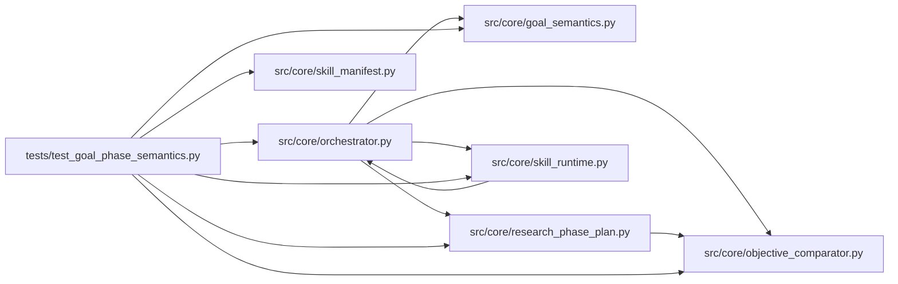

# test_goal_phase_semantics Module

**Path:** `tests/test_goal_phase_semantics.py`

## Description

Tests for explicit goal and phase semantics.

Contract: optimize and satisfice goals decide explicitly (no expressions, no
plugins); a satisfice threshold crossing is accepted with its evidence and
produces a distinct terminal success, while exhaustion and a never-observed
condition stay distinct from success. Declarative phase rules evaluate against
verified in-phase observations and declared min/max observation requirements;
model prose and unrelated or stale evidence never advance a phase. Plugin
phase/resolver modes are rejected explicitly, never silently substituted.

## Imports

| Source | Symbols |
|--------|---------|
| `__future__` | `annotations` |
| `anthropic` | `anthropic` |
| `json` | `json` |
| `pytest` | `pytest` |
| `src.core.goal_semantics` | `GOAL_INCONCLUSIVE`, `GOAL_SATISFICED`, `GOAL_THRESHOLD_UNMET`, `goal_decision`, `goal_outcome`, `threshold_evidence` |
| `src.core.objective_comparator` | `ObjectiveComparator` |
| `src.core.orchestrator` | `AgentOrchestrator`, `ResearchConfig` |
| `src.core.research_phase_plan` | `_completed_phase_ids` |
| `src.core.skill_manifest` | `ResearchSkillManifest` |
| `src.core.skill_runtime` | `ManifestSkillRuntime`, `UnsupportedPhaseAdvancementError` |
| `sys` | `sys` |
| `types` | `types`, `ModuleType`, `SimpleNamespace` |
| `typing` | `Any`, `Dict`, `List`, `Optional`, `cast` |
| `unittest.mock` | `MagicMock` |

## Local dependency map

<!-- Auto-generated local dependency summary. Do not edit by hand. -->

### Internal neighbors

| Direction | Module |
|---|---|
| Outbound | [goal_semantics](../modules/goal_semantics.md) |
| Outbound | [objective_comparator](../modules/objective_comparator.md) |
| Outbound | [orchestrator](../modules/orchestrator.md) |
| Outbound | [research_phase_plan](../modules/research_phase_plan.md) |
| Outbound | [skill_manifest](../modules/skill_manifest.md) |
| Outbound | [skill_runtime](../modules/skill_runtime.md) |

### External packages

| Language | Used packages | Undeclared packages |
|---|---:|---:|
| python | 2 | 2 |

## Classes

| Class | Line | Bases | Description |
|-------|------|-------|-------------|
| [_Store](../entities/test_goal_phase_semantics_Store.md) | 185 | — | — |

## Functions

| Function | Signature | Decorators | Description |
|----------|-----------|------------|-------------|
| `_metrics` | `(threshold: Optional[bool] = None, **extra: Any) -> Dict[str, Any]` | — | — |
| `_row` | `(iteration: int, metrics: Dict[str, Any], *, phase: str = 'validation', decision: str = 'keep', duplicate_reason: Optional[str] = None) -> Dict[str, Any]` | — | — |
| `_goal_skill` | `(*, goal: str = 'satisfice', threshold_field: str = 'met_target', phase_plan: Optional[List[Dict[str, Any]]] = None, advancement_mode: str = 'declarative', phase_override_mode: Optional[str] = None) -> SimpleNamespace` | — | — |
| `test_threshold_evidence_is_explicit` | `() -> None` | — | — |
| `test_satisfice_decisions_skip_winner_comparison` | `() -> None` | — | — |
| `test_optimize_decisions_stay_comparator_based` | `() -> None` | — | — |
| `test_goal_outcomes_keep_success_exhaustion_inconclusive_distinct` | `() -> None` | — | — |
| `_orch` | `(rows, skill)` | — | — |
| `_config` | `(**overrides)` | — | — |
| `test_threshold_crossing_accepts_and_nudges_termination` | *(async)* `() -> None` | `@pytest.mark.asyncio` | — |
| `test_rejected_rows_cannot_satisfy_the_goal` | *(async)* `() -> None` | `@pytest.mark.asyncio` | — |
| `test_terminal_success_reflects_the_declared_condition` | *(async)* `() -> None` | `@pytest.mark.asyncio` | — |
| `test_exhaustion_stays_distinct_from_success` | *(async)* `() -> None` | `@pytest.mark.asyncio` | — |
| `test_inconclusive_outcome_is_distinct_from_success_and_exhaustion` | *(async)* `() -> None` | `@pytest.mark.asyncio` | — |
| `_phase_spec` | `(pid, *, keys = (), min_iterations = 1)` | — | — |
| `test_phase_requires_in_phase_verified_evidence` | `() -> None` | — | — |
| `test_stale_unrelated_and_prose_evidence_never_advance_phases` | `() -> None` | — | — |
| `test_repeat_observations_satisfy_the_declared_minimum` | `() -> None` | — | — |
| `test_declared_validation_phase_follows_its_rule` | `() -> None` | — | — |
| `test_plugin_phase_modes_are_rejected_explicitly` | `() -> None` | — | — |
