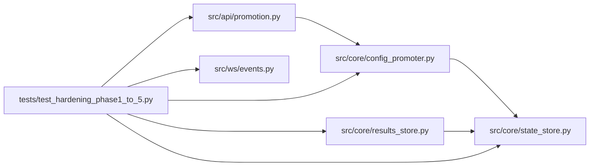

# test_hardening_phase1_to_5 Module

**Path:** `tests/test_hardening_phase1_to_5.py`

## Description

Tests for the autoresearch-agent hardening backlog (phases 1–5).

These tests target the focused behaviors changed in the hardening pass
documented in the ARC hardening backlog phases 1-5 (backlog doc not
retained — these tests are the record). Each
test exercises the surface that changed; full integration smoke tests
of the agent loop are out of scope for this file.

## Imports

| Source | Symbols |
|--------|---------|
| `__future__` | `annotations` |
| `aiosqlite` | `aiosqlite`, `aiosqlite` |
| `asyncio` | `asyncio` |
| `os` | `os` |
| `pathlib` | `Path` |
| `pydantic` | `ValidationError` |
| `pytest` | `pytest` |
| `src.api.promotion` | `PromotionApproval`, `PromotionScopeRequest` |
| `src.core.config_promoter` | `_atomic_write_text` |
| `src.core.results_store` | `ResultsStore`, `_add_column_if_missing` |
| `src.core.state_store` | `_LATEST_SCHEMA_VERSION` |
| `src.ws.events` | `EventBroadcaster` |
| `tempfile` | `tempfile` |
| `time` | `time` |

## Local dependency map

<!-- Auto-generated local dependency summary. Do not edit by hand. -->

### Internal neighbors

| Direction | Module |
|---|---|
| Outbound | [promotion](../modules/promotion.md) |
| Outbound | [config_promoter](../modules/config_promoter.md) |
| Outbound | [results_store](../modules/results_store.md) |
| Outbound | [state_store](../modules/state_store.md) |
| Outbound | [events](../modules/events.md) |

### External packages

| Language | Used packages | Undeclared packages |
|---|---:|---:|
| python | 3 | 2 |

## Classes

| Class | Line | Bases | Description |
|-------|------|-------|-------------|
| [_FakeWS](../entities/FakeWS.md) | 125 | — | — |

## Functions

| Function | Signature | Decorators | Description |
|----------|-----------|------------|-------------|
| `test_add_column_if_missing_is_idempotent` | *(async)* `(tmp_path: Path) -> None` | `@pytest.mark.asyncio` | — |
| `test_add_column_if_missing_propagates_real_errors` | *(async)* `(tmp_path: Path) -> None` | `@pytest.mark.asyncio` | — |
| `test_atomic_write_text_replaces_existing` | `(tmp_path: Path) -> None` | — | — |
| `test_atomic_write_text_creates_parent` | `(tmp_path: Path) -> None` | — | — |
| `test_production_scope_requires_full_approval` | `() -> None` | — | — |
| `test_production_scope_rejects_partial_approval` | `() -> None` | — | — |
| `test_production_scope_accepts_full_approval` | `() -> None` | — | — |
| `test_development_scope_does_not_require_approval` | `() -> None` | — | — |
| `test_broadcaster_drops_dead_clients_under_concurrent_churn` | *(async)* `() -> None` | `@pytest.mark.asyncio` | — |
| `test_broadcaster_rejects_clients_over_cap` | *(async)* `() -> None` | `@pytest.mark.asyncio` | — |
| `store` | *(async)* `(tmp_path: Path) -> ResultsStore` | `@pytest.fixture` | — |
| `test_list_sessions_status_in_filters_at_sql_level` | *(async)* `(store: ResultsStore) -> None` | `@pytest.mark.asyncio` | — |
| `test_results_store_records_schema_version` | *(async)* `(store: ResultsStore) -> None` | `@pytest.mark.asyncio` | — |
| `test_results_store_idempotency_records_replay_and_conflict` | *(async)* `(store: ResultsStore) -> None` | `@pytest.mark.asyncio` | — |
| `test_list_sessions_pagination` | *(async)* `(store: ResultsStore) -> None` | `@pytest.mark.asyncio` | — |
