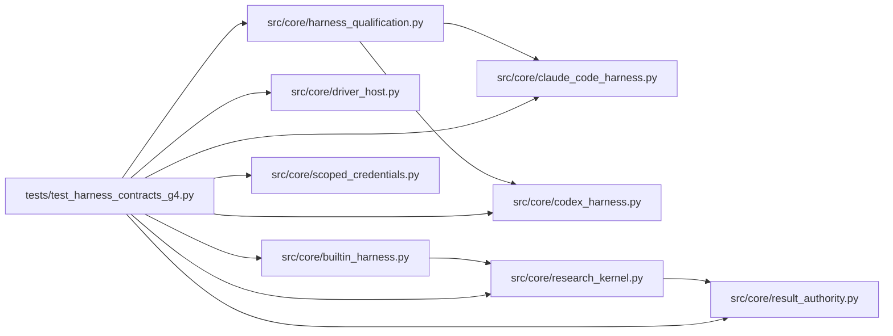

# test_harness_contracts_g4 Module

**Path:** `tests/test_harness_contracts_g4.py`

## Description

G4 qualification: one shared contract across every harness surface.

The built-in adapter, a custom process driver, the Codex and Claude Code
adapters, and the attached API/CLI workflow are qualified against one
shared conformance contract with explicit per-adapter capabilities.
Fixture and live evidence are reported separately: missing live evidence
blocks a compatibility claim. No managed or attached path may bypass the
evidence gate or scope rules, including receipt reuse across runs.

## Imports

| Source | Symbols |
|--------|---------|
| `__future__` | `annotations` |
| `json` | `json` |
| `pathlib` | `Path` |
| `pytest` | `pytest` |
| `src.core.builtin_harness` | `BuiltinHarnessAdapter` |
| `src.core.claude_code_harness` | `ClaudeCodeHarnessAdapter`, `normalize_claude_event`, `map_candidate_changes` |
| `src.core.codex_harness` | `CodexHarnessAdapter`, `normalize_codex_event`, `map_candidate_changes` |
| `src.core.driver_host` | `DriverHost`, `DriverHostConfig` |
| `src.core.harness_qualification` | `QualificationResult`, `claim_honesty`, `qualify_adapter`, `supported_matrix` |
| `src.core.research_kernel` | `verify_evidence` |
| `src.core.result_authority` | `issue_result_receipt` |
| `src.core.scoped_credentials` | `CredentialDenied`, `issue_scoped_credential`, `verify_scoped_credential`, `NON_GRANTABLE_PERMISSIONS` |
| `sys` | `sys` |

## Local dependency map

<!-- Auto-generated local dependency summary. Do not edit by hand. -->

### Internal neighbors

| Direction | Module |
|---|---|
| Outbound | [builtin_harness](../modules/builtin_harness.md) |
| Outbound | [claude_code_harness](../modules/claude_code_harness.md) |
| Outbound | [codex_harness](../modules/codex_harness.md) |
| Outbound | [driver_host](../modules/driver_host.md) |
| Outbound | [harness_qualification](../modules/harness_qualification.md) |
| Outbound | [research_kernel](../modules/research_kernel.md) |
| Outbound | [result_authority](../modules/result_authority.md) |
| Outbound | [scoped_credentials](../modules/scoped_credentials.md) |

### External packages

| Language | Used packages | Undeclared packages |
|---|---:|---:|
| python | 1 | 1 |

## Functions

| Function | Signature | Decorators | Description |
|----------|-----------|------------|-------------|
| `_scripted_attempt_fn` | `()` | — | — |
| `_permissions_scope_check` | `() -> bool` | — | G1 scope rules: scoped credentials never cross runs or gain |
| `test_shared_contract_across_managed_and_attached_surfaces` | `()` | — | — |
| `test_fixture_and_live_evidence_are_reported_separately` | `()` | — | — |
| `test_custom_process_driver_in_the_shared_contract` | `(tmp_path)` | — | — |
| `test_attached_api_cli_workflow_is_in_the_contract` | `(tmp_path, monkeypatch)` | — | — |
| `test_no_path_bypasses_g1_evidence_with_receipt_reuse` | `()` | — | A receipt from one run must never verify another run's result. |
| `test_driver_proposals_are_never_self_verified` | `()` | — | — |
