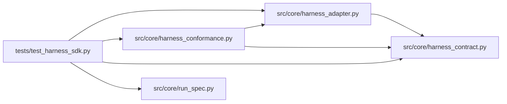

# test_harness_sdk Module

**Path:** `tests/test_harness_sdk.py`

## Description

Harness SDK: adapters, registry, capability negotiation, conformance.

The verification matrix: conforming and nonconforming fake adapters,
version mismatch, lifecycle ordering, cancelled start, cleanup, unknown
event compatibility, and the honesty rules (unsupported pause is explicit,
kill is never a successful pause, cross-harness continuation is never
claimed as native transcript resume).

## Imports

| Source | Symbols |
|--------|---------|
| `__future__` | `annotations` |
| `pytest` | `pytest` |
| `src.core.harness_adapter` | `HarnessRegistry`, `request_pause`, `request_steer`, `resolve_harness_spec`, `validate_requirements` |
| `src.core.harness_conformance` | `FakeHarnessAdapter`, `run_conformance` |
| `src.core.harness_contract` | `ATTACH_MODE_CONTINUATION`, `ATTACH_MODE_NATIVE_RESUME`, `CAPABILITY_PAUSE`, `CAPABILITY_RESUME`, `CAPABILITY_STEERING`, `HARNESS_CONTRACT_VERSION`, `HarnessContractError`, `HarnessLifecycleError`, `HarnessRequirementError`, `HarnessVersionError`, `UnsupportedCapabilityError` |
| `src.core.run_spec` | `build_run_spec`, `verify_run_spec` |

## Local dependency map

<!-- Auto-generated local dependency summary. Do not edit by hand. -->

### Internal neighbors

| Direction | Module |
|---|---|
| Outbound | [harness_adapter](../modules/harness_adapter.md) |
| Outbound | [harness_conformance](../modules/harness_conformance.md) |
| Outbound | [harness_contract](../modules/harness_contract.md) |
| Outbound | [run_spec](../modules/run_spec.md) |

### External packages

| Language | Used packages | Undeclared packages |
|---|---:|---:|
| python | 1 | 1 |

## Functions

| Function | Signature | Decorators | Description |
|----------|-----------|------------|-------------|
| `test_conforming_fake_passes_the_suite` | `()` | — | — |
| `test_nonconforming_fakes_fail_the_specific_check` | `(violation, expected_finding)` | `@pytest.mark.parametrize(('violation', 'expected_finding'), [('kill_as_pause', 'kill presented as pause'), ('native_claim_on_continuation', 'native transcript resume'), ('no_cleanup', 'closed handle'), ('events_before_start', 'unknown handle')])` | — |
| `test_capability_lie_is_reported` | `()` | — | — |
| `test_version_mismatch_is_refused_at_registration` | `()` | — | — |
| `test_lifecycle_ordering_and_cleanup` | `()` | — | — |
| `test_unknown_events_are_tolerated_and_marked` | `()` | — | — |
| `test_registering_a_new_adapter_needs_no_kernel_branch` | `()` | — | — |
| `test_unsupported_capabilities_refuse_explicitly` | `()` | — | — |
| `test_adapter_identity_resolves_into_the_run_spec` | `()` | — | — |
| `test_requirements_are_validated_before_launch` | `()` | — | — |
| `test_cross_harness_continuation_is_never_native_resume` | `()` | — | — |
| `test_cross_harness_native_claim_is_a_conformance_failure` | `()` | — | — |
