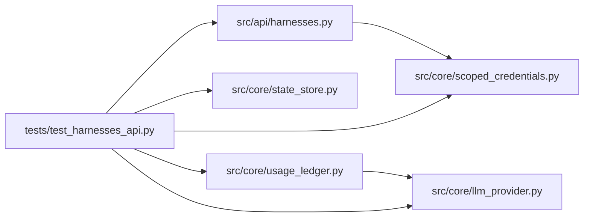

# test_harnesses_api Module

**Path:** `tests/test_harnesses_api.py`

## Description

Harness capability descriptors and run context: the UI's data source.

Every qualified harness is startable and inspectable without a name
branch; unsupported controls carry explicit reasons; unknown cost is
visibly unknown; lifecycle controls stay consistent with server
authorization.

## Imports

| Source | Symbols |
|--------|---------|
| `__future__` | `annotations` |
| `asyncio` | `asyncio` |
| `fastapi` | `FastAPI` |
| `fastapi.testclient` | `TestClient` |
| `json` | `json` |
| `pytest` | `pytest` |
| `src.api.harnesses` | `init`, `router` |
| `src.core.llm_provider` | `COST_UNAVAILABLE`, `Usage` |
| `src.core.scoped_credentials` | `PERM_LIFECYCLE`, `PERM_READ`, `PERM_SUBMIT`, `issue_scoped_credential` |
| `src.core.state_store` | `SQLiteStateStore` |
| `src.core.usage_ledger` | `UsageEvent` |

## Local dependency map

<!-- Auto-generated local dependency summary. Do not edit by hand. -->

### Internal neighbors

| Direction | Module |
|---|---|
| Outbound | [harnesses](../modules/harnesses.md) |
| Outbound | [llm_provider](../modules/llm_provider.md) |
| Outbound | [scoped_credentials](../modules/scoped_credentials.md) |
| Outbound | [state_store](../modules/state_store.md) |
| Outbound | [usage_ledger](../modules/usage_ledger.md) |

### External packages

| Language | Used packages | Undeclared packages |
|---|---:|---:|
| python | 2 | 2 |

## Functions

| Function | Signature | Decorators | Description |
|----------|-----------|------------|-------------|
| `store` | `(tmp_path)` | `@pytest.fixture` | — |
| `client` | `(store)` | `@pytest.fixture` | — |
| `_token` | `(run_id = 'res-ui', subject = 'agent-1', tenant = 'tenant-a', **kw)` | — | — |
| `test_descriptors_cover_every_harness_without_name_branches` | `(client)` | — | — |
| `test_unadvertised_capabilities_are_refused_not_substituted` | `(client)` | — | — |
| `test_run_context_reports_evidence_usage_and_resume` | `(client, store)` | — | — |
| `test_lifecycle_actions_are_capability_and_permission_aware` | `(client)` | — | — |
| `test_context_for_unregistered_harness_is_honest` | `(client, store)` | — | — |
