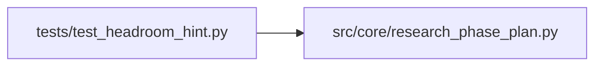

# test_headroom_hint Module

**Path:** `tests/test_headroom_hint.py`

## Description

DM-14 — per-phase ``headroom_hint`` surfaced in the state JSON +
appended to ``next_action`` when budget is tight.

Pins:

1. ``_phase_headroom_hint`` returns ``"high"`` for a fresh phase with
   no iterations touching its primary sweep keys.
2. ``_phase_headroom_hint`` returns ``"low"`` when ALL of the phase's
   primary sweep keys have been touched in this session.
3. ``_phase_headroom_hint`` returns ``"medium"`` for partial coverage
   AND for phases without a defined sweep-key list.
4. Every phase entry in ``build_phase_state``'s output carries the
   ``headroom_hint`` field.
5. ``_next_action`` appends a ``[headroom_hint: low — …]`` suffix when
   the active phase is low-headroom AND iterations_remaining < 30% of
   max_iterations.
6. The suffix is OMITTED when budget is ample (≥ 30% remaining) OR
   when ``iterations_remaining`` is None (no budget context).

## Imports

| Source | Symbols |
|--------|---------|
| `__future__` | `annotations` |
| `anthropic` | `anthropic` |
| `json` | `json` |
| `os` | `os` |
| `pathlib` | `Path` |
| `pytest` | `pytest` |
| `src.core.research_phase_plan` | `_PHASE_PRIMARY_SWEEP_KEYS`, `_next_action`, `_phase_headroom_hint`, `build_phase_state` |
| `sys` | `sys` |
| `types` | `types` |

## Local dependency map

<!-- Auto-generated local dependency summary. Do not edit by hand. -->

### Internal neighbors

| Direction | Module |
|---|---|
| Outbound | [research_phase_plan](../modules/research_phase_plan.md) |

### External packages

| Language | Used packages | Undeclared packages |
|---|---:|---:|
| python | 2 | 2 |

## Functions

| Function | Signature | Decorators | Description |
|----------|-----------|------------|-------------|
| `_iter_with_config` | `(config_keys: dict) -> dict` | — | Produce an iteration row whose ``metrics_json`` carries the |
| `_iter_with_top_level_keys` | `(keys: dict) -> dict` | — | Iteration row carrying the keys at metrics_json top level (the |
| `test_headroom_hint_high_for_fresh_phase` | `() -> None` | — | No iterations → no keys touched → all phases are fresh. |
| `test_headroom_hint_low_when_all_sweep_keys_touched` | `() -> None` | — | Cover every primary key for tabular_sweeps — hint must be ``low``. |
| `test_headroom_hint_medium_for_partial_coverage` | `() -> None` | — | One key out of four touched → partial → medium. |
| `test_headroom_hint_medium_for_phase_without_sweep_keys` | `() -> None` | — | Phases like ``baseline_capture`` / ``inference_parity_replay`` |
| `test_headroom_hint_accepts_top_level_keys_too` | `() -> None` | — | Iterations that surface the sweep key at metrics_json top level |
| `test_headroom_hint_handles_malformed_metrics_json` | `() -> None` | — | A row with non-JSON / non-dict metrics_json must not crash — |
| `test_phase_entries_carry_headroom_hint` | `() -> None` | — | — |
| `test_phase_entries_reflect_partial_coverage_via_state` | `() -> None` | — | End-to-end: feed iterations that touch one sweep key for |
| `_direction_phases_stub` | `()` | — | Minimal phase list mirroring research_phase_plan.DIRECTION_PHASES |
| `test_next_action_appends_low_hint_suffix_when_budget_tight` | `() -> None` | — | Active phase is low-headroom AND only 20% of budget remaining → |
| `test_next_action_omits_suffix_when_budget_ample` | `() -> None` | — | Low-headroom hint but plenty of budget remaining → no suffix |
| `test_next_action_omits_suffix_when_hint_not_low` | `() -> None` | — | High / medium hints don't trigger the suffix even at tight budget. |
| `test_next_action_omits_suffix_when_no_budget_context` | `() -> None` | — | ``iterations_remaining=None`` (e.g. when build_phase_state was |
| `test_next_action_suffix_combines_with_blocker_advisory` | `() -> None` | — | When a blocker is present AND the active phase is low-headroom |
