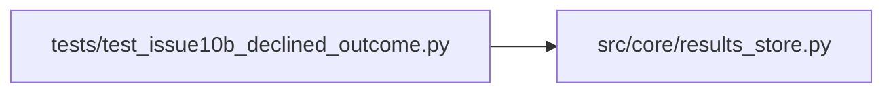

# test_issue10b_declined_outcome Module

**Path:** `tests/test_issue10b_declined_outcome.py`

## Description

Issue 10B — outcome taxonomy: distinguish ``declined`` from ``failed``.

A trained-successfully iteration (prepare.py ``status:completed``,
``all_gates_passed:true``) that the agent declined because the metric did not
beat best was previously recorded with ``outcome:"failed"``, conflating it
with crash/timeout/error and inflating dashboard failure rates. Live evidence:
session ``res_dd666f273f99`` had 16 of 23 iterations in this exact shape
(``decision:discard`` + ``status:completed`` + ``all_gates_passed:true``).

The fix introduces ``outcome:"declined"`` with precedence:

    consistency_blocked  >  declined  >  failed

so a consistency-blocked run (Issue 8) is still ``consistency_blocked``, a real
training crash is still ``failed``, and only the previously mis-tagged path
becomes ``declined``.

Behavior preserved for all other paths:
- crash/timeout/error/failed status → still ``failed``
- rejected_duplicate → still ``rejected_duplicate``
- pruned → still ``pruned``
- decision=keep WITHOUT consistency block → still ``completed``
- decision=discard WITH unknown/empty status → still ``failed`` (legacy
  fall-through preserved for non-success status)

## Imports

| Source | Symbols |
|--------|---------|
| `__future__` | `annotations` |
| `json` | `json` |
| `src.core.results_store` | `_attempt_outcome` |

## Local dependency map

<!-- Auto-generated local dependency summary. Do not edit by hand. -->

### Internal neighbors

| Direction | Module |
|---|---|
| Outbound | [results_store](../modules/results_store.md) |

## Functions

| Function | Signature | Decorators | Description |
|----------|-----------|------------|-------------|
| `_report` | `(passed: bool, blockers = None)` | — | — |
| `_row` | `(**kw)` | — | — |
| `test_completed_discard_with_passing_consistency_returns_declined` | `() -> None` | — | The Issue-10B scenario: training succeeded, gates passed, consistency |
| `test_success_discard_with_passing_consistency_returns_declined` | `() -> None` | — | `status: success` is treated equivalently to `completed`. |
| `test_completed_discard_without_consistency_report_returns_declined` | `() -> None` | — | Defensive: a missing consistency report is NOT a block. Older rows |
| `test_consistency_block_takes_precedence_over_declined` | `() -> None` | — | Issue 8 precedence preserved: a consistency-blocked discard stays |
| `test_crash_status_takes_precedence_over_declined` | `() -> None` | — | A real training failure beats the decision label: crash with |
| `test_timeout_status_takes_precedence_over_declined` | `() -> None` | — | — |
| `test_error_status_takes_precedence_over_declined` | `() -> None` | — | — |
| `test_pruned_takes_precedence_over_declined` | `() -> None` | — | — |
| `test_rejected_duplicate_takes_precedence_over_declined` | `() -> None` | — | — |
| `test_keep_decision_remains_completed` | `() -> None` | — | Issue 10B does not affect the keep path. |
| `test_improve_decision_remains_completed` | `() -> None` | — | — |
| `test_discard_with_unknown_status_still_failed` | `() -> None` | — | Defensive: discard with non-success status remains 'failed' so the |
| `test_discard_with_empty_status_still_failed` | `() -> None` | — | — |
