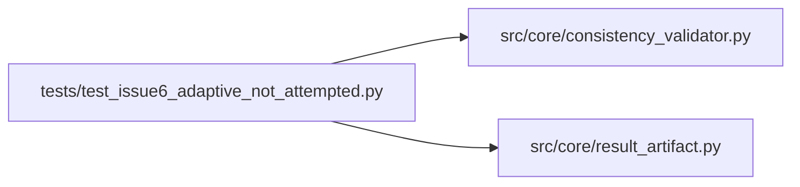

# test_issue6_adaptive_not_attempted Module

**Path:** `tests/test_issue6_adaptive_not_attempted.py`

## Description

Issue 6 — adaptive_feature_sweeps hard-block when adaptive is not attempted.

Root cause traced in live session res_0ca02946650e:
prepare.py correctly computes `adaptive_feature_noop_reason: "adaptive_
features_unavailable"` from the trainer's `adaptive_features.requested == False`
and prints it in the `---` block. But the trainer's `results.json` writes an
explicit `adaptive_feature_noop_reason: null` at top level, and
`merge_result_payload` (the orchestrator's result-artifact enricher) blindly
overwrites the parsed value with that null. The consistency validator then
hard-blocks with `adaptive_feature_not_enabled` for what is really a
"not attempted yet" iteration.

Two fixes:
- Fix A (primary, root cause): the enricher must not nullify a marker value
  with an explicit None from results.json. Apply to both nested and
  top-level result keys.
- Fix B (defense in depth): check_adaptive_feature_sweep must treat
  `requested=False AND enabled=False AND no noop_reason` as legitimate
  "not attempted" (return None). The adaptive_feature_not_enabled blocker is
  reserved for the gaming-detection case (already covered by the
  requested=True+enabled=False branch as adaptive_feature_requested_but_inactive).

## Imports

| Source | Symbols |
|--------|---------|
| `__future__` | `annotations` |
| `src.core.consistency_validator` | `check_adaptive_feature_sweep` |
| `src.core.result_artifact` | `merge_result_payload` |

## Local dependency map

<!-- Auto-generated local dependency summary. Do not edit by hand. -->

### Internal neighbors

| Direction | Module |
|---|---|
| Outbound | [consistency_validator](../modules/consistency_validator.md) |
| Outbound | [result_artifact](../modules/result_artifact.md) |

## Functions

| Function | Signature | Decorators | Description |
|----------|-----------|------------|-------------|
| `test_fixa_top_level_null_does_not_overwrite_marker_string` | `()` | — | The exact Issue-6 shape: prepare.py parsed |
| `test_fixa_top_level_real_value_still_overwrites` | `()` | — | Regression: a non-None artifact value still wins (existing behavior). |
| `test_fixa_top_level_marker_absent_then_null_is_harmless` | `()` | — | When the marker has no value AND the payload is None, the merge |
| `test_fixa_nested_null_does_not_overwrite_dict` | `()` | — | Nested key (e.g. adaptive_features) — explicit None in payload must |
| `test_fixa_nested_dict_still_deep_merges` | `()` | — | Regression: when both marker and payload have a dict for the key, the |
| `_af` | `(**kwargs)` | — | Build an adaptive_features dict resembling what direction/prepare.py emits. |
| `test_fixb_not_requested_and_not_enabled_is_not_blocker` | `()` | — | The exact Issue-6 case: agent ran prepare.py without requesting adaptive |
| `test_fixb_requested_but_not_enabled_still_blocks_gaming` | `()` | — | Regression: the gaming-detection branch must still fire when the agent |
| `test_fixb_enabled_but_no_selected_features_still_blocks` | `()` | — | Regression: enabled but selected_count<=0 still raises the |
| `test_fixb_accepted_noop_still_passes` | `()` | — | Regression: an accepted noop reason still bypasses all checks. |
| `test_fixb_genuine_enabled_with_features_passes` | `()` | — | Regression: a genuine adaptive sweep (enabled + selected features) passes. |
