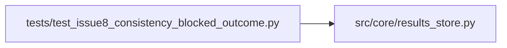

# test_issue8_consistency_blocked_outcome Module

**Path:** `tests/test_issue8_consistency_blocked_outcome.py`

## Description

Issue 8 — outcome taxonomy: distinguish consistency-blocked from training-failed.

A trained-successfully iteration (prepare.py status:completed, all_gates_passed:true)
whose only failure is a downstream consistency-validator block was previously
recorded with ``outcome:"failed"``, conflating it with crash/timeout/error. The
fix introduces ``outcome:"consistency_blocked"`` so retry/UI logic can treat
the two cases distinctly (do NOT retry as transient; address the blocker).

Behavior preserved for all other paths:
- crash/timeout/error/failed status → still "failed"
- rejected_duplicate → still "rejected_duplicate"
- pruned → still "pruned"
- decision=discard WITHOUT consistency block → still "failed"
- decision=keep WITHOUT consistency block → still "completed"

## Imports

| Source | Symbols |
|--------|---------|
| `__future__` | `annotations` |
| `json` | `json` |
| `src.core.results_store` | `_attempt_outcome` |

## Local dependency map

<!-- Auto-generated local dependency summary. Do not edit by hand. -->

### Internal neighbors

| Direction | Module |
|---|---|
| Outbound | [results_store](../modules/results_store.md) |

## Functions

| Function | Signature | Decorators | Description |
|----------|-----------|------------|-------------|
| `_report` | `(passed: bool, blockers = None)` | — | — |
| `_row` | `(**kw)` | — | — |
| `test_consistency_blocked_discard_returns_new_label` | `()` | — | The Issue-6/8 scenario: training succeeded, gates passed, but |
| `test_consistency_blocked_keep_also_returns_new_label` | `()` | — | Decision is keep/discard answers a different question (metric improvement); |
| `test_consistency_blocked_with_success_status_returns_new_label` | `()` | — | `status: success` is treated equivalently to `completed`. |
| `test_unchanged_real_training_crash_still_failed` | `()` | — | — |
| `test_unchanged_rejected_duplicate_still_rejected_duplicate` | `()` | — | — |
| `test_unchanged_pruned_still_pruned` | `()` | — | — |
| `test_unchanged_completed_keep_with_passing_consistency` | `()` | — | — |
| `test_completed_discard_with_passing_consistency_now_declined` | `()` | — | Issue 10B updated this assertion: completed + decision=discard + |
| `test_unchanged_completed_when_no_consistency_report` | `()` | — | Defensive: missing consistency_report_json must not raise and must |
| `test_malformed_consistency_report_does_not_raise` | `()` | — | Defensive: invalid JSON in consistency_report_json is treated as 'no |
| `test_consistency_report_as_dict_also_accepted` | `()` | — | Some code paths may pass the report as a dict rather than JSON string. |
