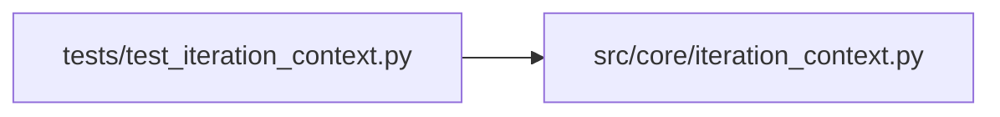

# test_iteration_context Module

**Path:** `tests/test_iteration_context.py`

## Description

_Auto-generated from `tests/test_iteration_context.py`._

## Imports

| Source | Symbols |
|--------|---------|
| `__future__` | `annotations` |
| `json` | `json` |
| `src.core.iteration_context` | `ITERATION_CONTEXT_DIGEST_MARKER`, `build_iteration_context_digest` |

## Local dependency map

<!-- Auto-generated local dependency summary. Do not edit by hand. -->

### Internal neighbors

| Direction | Module |
|---|---|
| Outbound | [iteration_context](../modules/iteration_context.md) |

## Functions

| Function | Signature | Decorators | Description |
|----------|-----------|------------|-------------|
| `test_iteration_context_digest_summarizes_best_recent_blockers_and_duplicates` | `()` | — | — |
| `test_iteration_context_digest_respects_cap` | `()` | — | — |
| `test_iteration_context_digest_handles_empty_iterations` | `()` | — | — |
| `test_digest_lists_tried_configs_for_dedup_foresight` | `()` | — | Action 5: the digest enumerates distinct configs already attempted this |
| `test_digest_tried_configs_dedupes_repeated_hash` | `()` | — | — |
