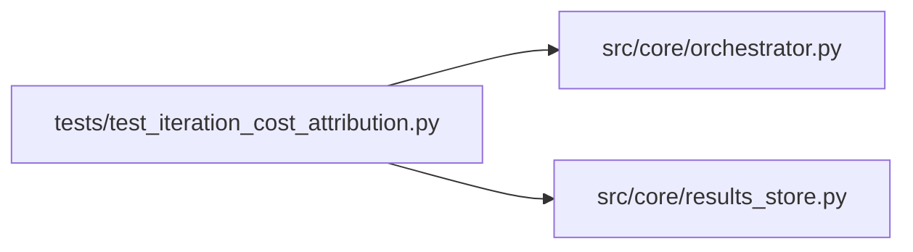

# test_iteration_cost_attribution Module

**Path:** `tests/test_iteration_cost_attribution.py`

## Description

Fix F: per-iteration API cost attribution.

`_record_iteration` used to leave every row's ``api_cost_usd`` at 0.0 — only
the session total was stored, so spend could not be attributed to iterations.
It now records the as-yet-unattributed portion of the cumulative cost, which is
ordering-independent: the turn's cost lands on the first iteration recorded
that turn.

## Imports

| Source | Symbols |
|--------|---------|
| `__future__` | `annotations` |
| `pathlib` | `Path` |
| `pytest` | `pytest` |
| `src.core.orchestrator` | `AgentOrchestrator` |
| `src.core.results_store` | `ResultsStore` |
| `typing` | `Any`, `Dict` |

## Local dependency map

<!-- Auto-generated local dependency summary. Do not edit by hand. -->

### Internal neighbors

| Direction | Module |
|---|---|
| Outbound | [orchestrator](../modules/orchestrator.md) |
| Outbound | [results_store](../modules/results_store.md) |

### External packages

| Language | Used packages | Undeclared packages |
|---|---:|---:|
| python | 1 | 1 |

## Functions

| Function | Signature | Decorators | Description |
|----------|-----------|------------|-------------|
| `_create_session` | *(async)* `(store: ResultsStore, session_id: str) -> None` | — | — |
| `_marker` | `(metric: float, cfg: str, phase: str = 'tabular_sweeps') -> Dict[str, Any]` | — | — |
| `test_per_iteration_cost_is_delta_of_cumulative` | *(async)* `(tmp_path: Path) -> None` | `@pytest.mark.asyncio` | — |
| `test_sibling_iterations_same_turn_do_not_double_count` | *(async)* `(tmp_path: Path) -> None` | `@pytest.mark.asyncio` | Two iterations recorded in one turn share the same cumulative — the |
