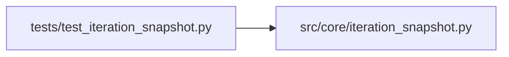

# test_iteration_snapshot Module

**Path:** `tests/test_iteration_snapshot.py`

## Description

_Auto-generated from `tests/test_iteration_snapshot.py`._

## Imports

| Source | Symbols |
|--------|---------|
| `__future__` | `annotations` |
| `json` | `json` |
| `pathlib` | `Path` |
| `src.core.iteration_snapshot` | `build_iteration_attempt_snapshot`, `build_trial_identity`, `canonical_config_hash`, `trial_identity_hash`, `write_iteration_attempt_snapshot` |

## Local dependency map

<!-- Auto-generated local dependency summary. Do not edit by hand. -->

### Internal neighbors

| Direction | Module |
|---|---|
| Outbound | [iteration_snapshot](../modules/iteration_snapshot.md) |

## Functions

| Function | Signature | Decorators | Description |
|----------|-----------|------------|-------------|
| `test_iteration_attempt_snapshot_hashes_config_and_writes_file` | `(tmp_path: Path)` | — | — |
| `test_trial_identity_hash_distinguishes_seed_mode_and_split` | `()` | — | — |
| `_rl_identity` | `(config_snapshot, *, source_model_ids = None)` | — | — |
| `test_source_model_ids_distinguish_upstream_model_swaps` | `()` | — | Folding upstream direction/volatility run-ids into data_split_id makes a run |
| `test_explicit_split_id_without_sources_is_unchanged` | `()` | — | A bare explicit split id with no source models is returned verbatim (the |
