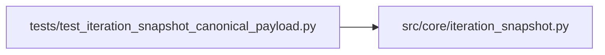

# test_iteration_snapshot_canonical_payload Module

**Path:** `tests/test_iteration_snapshot_canonical_payload.py`

## Description

AR-1: Tests for canonical_config_payload / canonical_config_hash hardening.

Covers the crash path where the LLM emits ``config_snapshot`` as a JSON object
(Python dict) instead of a YAML text string, e.g.:
  ITERATION_RESULT: {"config_snapshot": {"learning_rate": 0.001, ...}, ...}

## Imports

| Source | Symbols |
|--------|---------|
| `__future__` | `annotations` |
| `hashlib` | `hashlib` |
| `json` | `json` |
| `pytest` | `pytest` |
| `src.core.iteration_snapshot` | `build_iteration_attempt_snapshot`, `build_trial_identity`, `canonical_config_hash`, `canonical_config_payload` |

## Local dependency map

<!-- Auto-generated local dependency summary. Do not edit by hand. -->

### Internal neighbors

| Direction | Module |
|---|---|
| Outbound | [iteration_snapshot](../modules/iteration_snapshot.md) |

### External packages

| Language | Used packages | Undeclared packages |
|---|---:|---:|
| python | 1 | 1 |

## Functions

| Function | Signature | Decorators | Description |
|----------|-----------|------------|-------------|
| `test_canonical_config_payload_handles_dict_input` | `()` | — | Dict input must canonicalise without raising AttributeError. |
| `test_canonical_config_payload_dict_keys_sorted` | `()` | — | Dict path must sort keys for deterministic output. |
| `test_canonical_config_payload_nested_dict_input` | `()` | — | Nested dicts within a dict config_snapshot are canonicalised recursively. |
| `test_canonical_config_payload_handles_yaml_string` | `()` | — | YAML string input still works (regression guard for existing behaviour). |
| `test_canonical_config_payload_handles_none` | `()` | — | None input returns None. |
| `test_canonical_config_payload_handles_empty_string` | `()` | — | Empty string returns empty dict (not None). |
| `test_canonical_config_payload_handles_list_input` | `()` | — | List input canonicalises without exception. |
| `test_canonical_config_payload_handles_tuple_input` | `()` | — | Tuple input is treated like a list. |
| `test_canonical_config_hash_stable_across_dict_and_equivalent_yaml` | `()` | — | A dict and its YAML-serialised equivalent must produce the same hash. |
| `test_canonical_config_hash_stable_across_key_order` | `()` | — | Key order must not affect the hash (both dict and YAML paths). |
| `test_canonical_config_hash_none_returns_none` | `()` | — | — |
| `test_canonical_config_hash_dict_is_deterministic` | `()` | — | Repeated calls with the same dict must return the same hash. |
| `test_build_trial_identity_dict_config_snapshot_no_crash` | `()` | — | build_trial_identity must not crash when config_snapshot is a dict. |
| `test_build_trial_identity_dict_and_yaml_produce_same_hash` | `()` | — | dict and YAML-string config_snapshot produce the same canonical hash. |
| `test_build_iteration_attempt_snapshot_dict_config_snapshot_no_crash` | `(tmp_path)` | — | build_iteration_attempt_snapshot must not crash when config_snapshot is a dict. |
