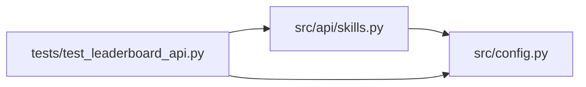

# test_leaderboard_api Module

**Path:** `tests/test_leaderboard_api.py`

## Description

GET /skills/{id}/leaderboard contract tests (P0-4).

## Imports

| Source | Symbols |
|--------|---------|
| `__future__` | `annotations` |
| `fastapi` | `FastAPI` |
| `fastapi.testclient` | `TestClient` |
| `os` | `os` |
| `pytest` | `pytest` |
| `src.api` | `skills` |
| `src.api.skills` | `router` |
| `src.config` | `settings` |

## Local dependency map

<!-- Auto-generated local dependency summary. Do not edit by hand. -->

### Internal neighbors

| Direction | Module |
|---|---|
| Outbound | [src_api_skills](../modules/src_api_skills.md) |
| Outbound | [config](../modules/config.md) |

### External packages

| Language | Used packages | Undeclared packages |
|---|---:|---:|
| python | 2 | 2 |

## Classes

| Class | Line | Bases | Description |
|-------|------|-------|-------------|
| [_FakeStore](../entities/test_leaderboard_api_FakeStore.md) | 20 | — | Minimal list_sessions double: two scored sessions + one unscored. |

## Functions

| Function | Signature | Decorators | Description |
|----------|-----------|------------|-------------|
| `create_test_app` | `() -> FastAPI` | — | — |
| `configure_auth` | `(monkeypatch: pytest.MonkeyPatch)` | `@pytest.fixture(autouse=True)` | — |
| `client` | `() -> TestClient` | `@pytest.fixture` | — |
| `auth_headers` | `() -> dict[str, str]` | — | — |
| `test_leaderboard_unknown_skill_404` | `(client: TestClient)` | — | — |
| `test_leaderboard_requires_auth` | `(client: TestClient)` | — | — |
| `test_leaderboard_sorts_and_filters` | `(client: TestClient, monkeypatch)` | — | — |
| `test_leaderboard_respects_limit` | `(client: TestClient, monkeypatch)` | — | — |
| `test_leaderboard_graceful_without_store` | `(client: TestClient, monkeypatch)` | — | — |
