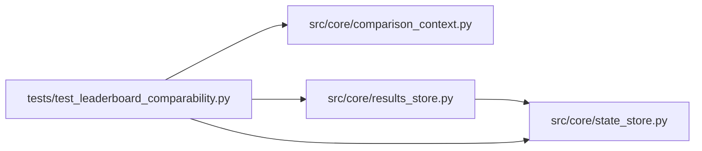

# test_leaderboard_comparability Module

**Path:** `tests/test_leaderboard_comparability.py`

## Description

Comparable-context leaderboard ranking over real storage history.

Mixed-context and >500-session fixtures expose the recent-500 bug: an
older champion must remain rankable while the API describes the ranking
as global. Incomparable and legacy contexts never merge into one
champion table; minimize/maximize parity holds; pagination windows are
explicit; and the ranking path's query plan is index-backed.

## Imports

| Source | Symbols |
|--------|---------|
| `__future__` | `annotations` |
| `asyncio` | `asyncio` |
| `src.core.comparison_context` | `build_comparison_context`, `describe_comparison_context` |
| `src.core.results_store` | `ResultsStore` |
| `src.core.state_store` | `SQLiteStateStore` |

## Local dependency map

<!-- Auto-generated local dependency summary. Do not edit by hand. -->

### Internal neighbors

| Direction | Module |
|---|---|
| Outbound | [comparison_context](../modules/comparison_context.md) |
| Outbound | [results_store](../modules/results_store.md) |
| Outbound | [state_store](../modules/state_store.md) |

## Functions

| Function | Signature | Decorators | Description |
|----------|-----------|------------|-------------|
| `_store` | `(tmp_path, name = 'state.db')` | — | — |
| `_seed` | `(store, rid, metric, *, context = None, model_type = 'prompt-engineering')` | — | — |
| `test_mixed_contexts_never_share_a_winner` | `(tmp_path)` | — | — |
| `test_old_champions_survive_beyond_recent_500` | `(tmp_path)` | — | — |
| `test_minimize_maximize_parity` | `(tmp_path)` | — | — |
| `test_pagination_boundaries_are_explicit` | `(tmp_path)` | — | — |
| `test_ranking_query_plan_is_index_backed` | `(tmp_path)` | — | — |
| `test_context_identity_and_labels` | `()` | — | — |
