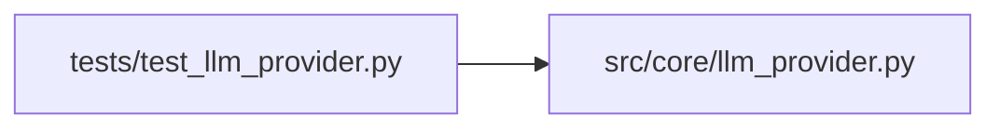

# test_llm_provider Module

**Path:** `tests/test_llm_provider.py`

## Description

Structural / contract tests for the ``LLMProvider`` protocol + types
(ARC-011 P1-001) and the ``AnthropicProvider`` (P1-002).

P1-001 introduced the protocol + normalized value types; P1-002 added the
``AnthropicProvider`` SDK adapter to the same module. These tests pin the
public surface, the R5 ``StopReason`` mapping, and frozen-ness of the value
types. (P1-001's headless-import test is dropped: P1-002 intentionally made
``llm_provider`` depend on ``anthropic`` at module level for the adapter; the
transitive dependency is the same as the pre-refactor orchestrator's direct
``import anthropic``.)

## Imports

| Source | Symbols |
|--------|---------|
| `__future__` | `annotations` |
| `dataclasses` | `FrozenInstanceError`, `fields`, `is_dataclass` |
| `inspect` | `inspect` |
| `pytest` | `pytest` |
| `src.core.llm_provider` | `ErrorClass`, `LLMProvider`, `Message`, `ProviderCapabilities`, `ProviderResponse`, `StopReason`, `StreamDelta`, `TextBlock`, `ToolDef`, `ToolResultBlock`, `ToolUseBlock`, `Usage` |

## Local dependency map

<!-- Auto-generated local dependency summary. Do not edit by hand. -->

### Internal neighbors

| Direction | Module |
|---|---|
| Outbound | [llm_provider](../modules/llm_provider.md) |

### External packages

| Language | Used packages | Undeclared packages |
|---|---:|---:|
| python | 1 | 1 |

## Functions

| Function | Signature | Decorators | Description |
|----------|-----------|------------|-------------|
| `test_stop_reason_members_match_r5_contract` | `()` | — | ``StopReason`` is the R5-critical enum the loop keys off (spike §5). |
| `test_value_types_are_frozen_and_construct_correctly` | `(cls, kwargs)` | `@pytest.mark.parametrize('cls,kwargs', [(Usage, {'input_tokens': 100, 'output_tokens': 50}), (TextBlock, {'text': 'hi'}), (ToolUseBlock, {'id': 't1', 'name': 'bash', 'input': {'command': 'ls'}}), (ToolResultBlock, {'tool_use_id': 't1', 'content': 'ok'}), (Message, {'role': 'user', 'content': 'hello'}), (Message, {'role': 'assistant', 'content': [TextBlock(text='hi')]}), (ToolDef, {'name': 'bash', 'description': 'd', 'input_schema': {}}), (ProviderResponse, {'content': [TextBlock(text='x')], 'stop_reason': StopReason.END_TURN, 'usage': Usage(input_tokens=1, output_tokens=1), 'raw_model': 'claude-test'}), (ProviderCapabilities, {'native_tool_use': True, 'streaming': False, 'system_prompt': True, 'max_context_tokens': 200000}), (ErrorClass, {'transient': True, 'status_code': 429, 'retry_after_s': 30.0}), (StreamDelta, {'text': 'partial'}), (StreamDelta, {})])` | Every value type is a frozen dataclass with the documented fields. |
| `test_minimal_provider_satisfies_protocol` | `()` | — | Executable documentation of the contract (signature-drift guard). |
