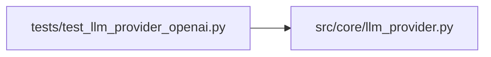

# test_llm_provider_openai Module

**Path:** `tests/test_llm_provider_openai.py`

## Description

P4-011 — Cross-provider parity tests for ``OpenAIProvider`` (ARC-011 R4/R5).

Pins the Chat Completions wire translation and the R5 stop-reason invariant.
Mirrors ``test_anthropic_provider.py`` (P1-002) in structure.

## Imports

| Source | Symbols |
|--------|---------|
| `__future__` | `annotations` |
| `json` | `json` |
| `openai` | `openai` |
| `pytest` | `pytest` |
| `src.core.llm_provider` | `Message`, `OpenAIProvider`, `ProviderCapabilities`, `StopReason`, `TextBlock`, `ToolDef`, `ToolResultBlock`, `ToolUseBlock`, `Usage`, `_from_openai_response`, `_to_openai_messages`, `_to_openai_tools` |
| `sys` | `sys` |
| `types` | `types` |
| `typing` | `Any` |
| `unittest.mock` | `AsyncMock`, `MagicMock` |

## Local dependency map

<!-- Auto-generated local dependency summary. Do not edit by hand. -->

### Internal neighbors

| Direction | Module |
|---|---|
| Outbound | [llm_provider](../modules/llm_provider.md) |

### External packages

| Language | Used packages | Undeclared packages |
|---|---:|---:|
| python | 2 | 1 |

## Classes

| Class | Line | Bases | Description |
|-------|------|-------|-------------|
| [TestToOpenAIMessages](../entities/TestToOpenAIMessages.md) | 89 | — | — |
| [TestToOpenAITools](../entities/TestToOpenAITools.md) | 125 | — | — |
| [TestFromOpenAIResponse](../entities/TestFromOpenAIResponse.md) | 134 | — | — |
| [TestMessagesCreate](../entities/TestMessagesCreate.md) | 167 | — | — |
| [TestComplete](../entities/TestComplete.md) | 188 | — | — |
| [TestClassifyError](../entities/TestClassifyError.md) | 200 | — | — |
| [TestEstimateCost](../entities/TestEstimateCost.md) | 222 | — | — |
| [TestCapabilities](../entities/TestCapabilities.md) | 236 | — | — |
| [TestBuildProvider](../entities/TestBuildProvider.md) | 245 | — | — |
| [TestCapabilityMatching](../entities/TestCapabilityMatching.md) | 268 | — | P4-009: ``build_provider(required_capabilities=...)`` validates the |

## Functions

| Function | Signature | Decorators | Description |
|----------|-----------|------------|-------------|
| `_oai_tool_call` | `(tc_id: str, name: str, arguments: str) -> Any` | — | — |
| `_oai_response` | `(*, content = None, tool_calls = None, finish_reason = 'stop', model = 'gpt-4o', prompt_tokens = 10, completion_tokens = 5) -> Any` | — | — |
| `_make_provider` | `() -> OpenAIProvider` | — | — |
