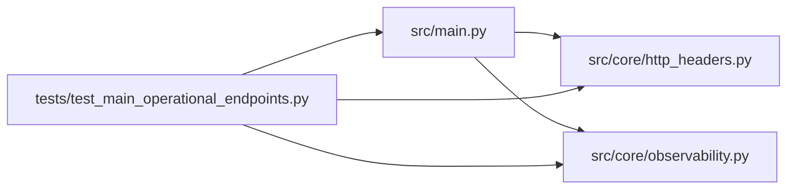

# test_main_operational_endpoints Module

**Path:** `tests/test_main_operational_endpoints.py`

## Description

_Auto-generated from `tests/test_main_operational_endpoints.py`._

## Imports

| Source | Symbols |
|--------|---------|
| `__future__` | `annotations` |
| `fastapi.testclient` | `TestClient` |
| `pytest` | `pytest` |
| `src` | `main` |
| `src.core.http_headers` | `bind_request_headers` |
| `src.core.observability` | `empty_observability_snapshot` |
| `typing` | `Any` |

## Local dependency map

<!-- Auto-generated local dependency summary. Do not edit by hand. -->

### Internal neighbors

| Direction | Module |
|---|---|
| Outbound | [http_headers](../modules/http_headers.md) |
| Outbound | [observability](../modules/observability.md) |
| Outbound | [src_main](../modules/src_main.md) |

### External packages

| Language | Used packages | Undeclared packages |
|---|---:|---:|
| python | 2 | 2 |

## Classes

| Class | Line | Bases | Description |
|-------|------|-------|-------------|
| [FakeSessionManager](../entities/test_main_operational_endpoints_FakeSessionManager.md) | 13 | — | — |
| [FakeStore](../entities/test_main_operational_endpoints_FakeStore.md) | 17 | — | — |

## Functions

| Function | Signature | Decorators | Description |
|----------|-----------|------------|-------------|
| `client` | `(monkeypatch: pytest.MonkeyPatch) -> TestClient` | `@pytest.fixture` | — |
| `test_metrics_returns_404_when_scrape_token_unset` | `(client: TestClient) -> None` | — | — |
| `test_metrics_exports_prometheus_client_runtime_and_custom_metrics` | `(client: TestClient, monkeypatch: pytest.MonkeyPatch) -> None` | — | — |
| `test_metrics_scrape_token_gate` | `(client: TestClient, monkeypatch: pytest.MonkeyPatch) -> None` | — | — |
| `test_monitoring_health_reports_preflight_details` | `(client: TestClient) -> None` | — | — |
| `test_info_reports_service_metadata` | `(client: TestClient) -> None` | — | — |
| `test_unknown_api_v1_path_returns_404` | `(client: TestClient) -> None` | — | — |
| `test_app_has_request_header_dependency` | `() -> None` | — | — |
| `test_runtime_config_requires_metrics_token_in_production` | `(monkeypatch: pytest.MonkeyPatch) -> None` | — | — |
| `test_runtime_config_rejects_multiple_workers` | `(monkeypatch: pytest.MonkeyPatch) -> None` | — | SQLite backend (no database_url) ⇒ WEB_CONCURRENCY>1 still rejected. |
| `test_runtime_config_allows_multiple_workers_on_postgres` | `(monkeypatch: pytest.MonkeyPatch) -> None` | — | Postgres backend ⇒ WEB_CONCURRENCY>1 is allowed. |
| `test_runtime_config_rejects_multiple_workers_on_sqlite_url` | `(monkeypatch: pytest.MonkeyPatch) -> None` | — | A sqlite:// database_url does NOT unlock multi-worker. |
| `test_readiness_reports_internal_state` | `(client: TestClient) -> None` | — | — |
