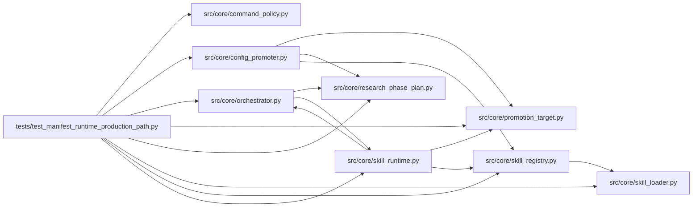

# test_manifest_runtime_production_path Module

**Path:** `tests/test_manifest_runtime_production_path.py`

## Description

ARC-011 implementation review C2 (2026-08-15) — the manifest-driven runtime
is the production path.

The review found the orchestrator bypassed the materialized ``SkillRuntime``
for everything except ``parse_iteration``: the phase plan came from the
hardcoded ``phases_for_model`` table, the system prompt from the legacy
``_load_skill`` map, command gating from the global ``_ALLOWED_SCRIPTS`` (the
manifest ``command_policy`` section was dead config), the blocker
classification from module constants, and promotion always used the implicit
file target. These tests pin the C2 fixes:

* C2-1  phase plan sourced from the skill runtime (prompt contract +
        ``build_phase_state`` / ``_refresh_phase_state``)
* C2-2  packaged primer for manifest sessions (incl. the manifest-declared
        primer filename)
* C2-3  ``command_policy_extension`` consumed by ``evaluate_command_policy``
        (additive-only)
* C2-4  ``blocker_classification`` consumed (actionable blockers + phase
        evidence keys)
* C2-5  promotion routed through the skill's declared target; unsupported
        kinds skip loudly instead of silently writing a file
* materialization fails loudly for an explicit unknown ``skill_id`` (no
  silent transitional downgrade)

## Imports

| Source | Symbols |
|--------|---------|
| `__future__` | `annotations` |
| `anthropic` | `anthropic` |
| `asyncio` | `asyncio` |
| `hashlib` | `hashlib` |
| `json` | `json` |
| `os` | `os` |
| `pathlib` | `Path` |
| `pytest` | `pytest` |
| `src.core` | `config_promoter`, `orchestrator`, `skill_registry` |
| `src.core.command_policy` | `evaluate_command_policy` |
| `src.core.orchestrator` | `AgentOrchestrator`, `ResearchConfig`, `_load_packaged_skill_md` |
| `src.core.promotion_target` | `FilePathPromotionTarget`, `WebhookPromotionTarget` |
| `src.core.research_phase_plan` | `build_phase_state`, `phases_for_model` |
| `src.core.skill_loader` | `load_skill_manifest` |
| `src.core.skill_registry` | `SkillRegistry`, `default_registry` |
| `src.core.skill_runtime` | `ManifestSkillRuntime`, `SkillConfigError`, `materialize_skill_runtime` |
| `sys` | `sys` |
| `types` | `types` |
| `typing` | `Any`, `Dict`, `List`, `Optional` |
| `unittest.mock` | `MagicMock` |
| `yaml` | `yaml`, `yaml` |

## Local dependency map

<!-- Auto-generated local dependency summary. Do not edit by hand. -->

### Internal neighbors

| Direction | Module |
|---|---|
| Outbound | [command_policy](../modules/command_policy.md) |
| Outbound | [config_promoter](../modules/config_promoter.md) |
| Outbound | [orchestrator](../modules/orchestrator.md) |
| Outbound | [promotion_target](../modules/promotion_target.md) |
| Outbound | [research_phase_plan](../modules/research_phase_plan.md) |
| Outbound | [skill_loader](../modules/skill_loader.md) |
| Outbound | [skill_registry](../modules/skill_registry.md) |
| Outbound | [skill_runtime](../modules/skill_runtime.md) |

### External packages

| Language | Used packages | Undeclared packages |
|---|---:|---:|
| python | 3 | 2 |

## Classes

| Class | Line | Bases | Description |
|-------|------|-------|-------------|
| [_FakePlanStore](../entities/FakePlanStore.md) | 175 | — | Minimal store surface for ``_refresh_phase_state``. |
| [_GenuinenessStore](../entities/GenuinenessStore.md) | 331 | — | — |
| [_ProbeBlockerSkill](../entities/ProbeBlockerSkill.md) | 342 | — | — |
| [_AutoPromoteStore](../entities/AutoPromoteStore.md) | 414 | — | — |
| [_FakeAgentLog](../entities/test_manifest_runtime_production_path_FakeAgentLog.md) | 451 | — | — |
| [_RegistryApiSkill](../entities/RegistryApiSkill.md) | 459 | — | — |

## Functions

| Function | Signature | Decorators | Description |
|----------|-----------|------------|-------------|
| `_manifest` | `(skill_id: str)` | — | — |
| `_file_path_manifest` | `()` | — | A synthetic ``file_path``-promotion manifest (no installed skill uses |
| `_config` | `(**overrides: Any) -> ResearchConfig` | — | — |
| `test_phase_contract_block_sources_from_manifest_not_constants` | `(monkeypatch)` | — | With ``skill_id`` set, the prompt's phase contract renders the |
| `test_skill_phase_plan_none_for_legacy_sessions` | `()` | — | — |
| `test_build_phase_state_accepts_explicit_phase_override` | `()` | — | The ``phases=`` parameter (C2-1) lets callers source the operator-facing |
| `test_refresh_phase_state_uses_session_skill_plan` | *(async)* `()` | `@pytest.mark.asyncio` | ``_refresh_phase_state`` derives the plan from the bound skill runtime |
| `test_load_packaged_skill_md_reads_package_primer` | `()` | — | — |
| `test_load_packaged_skill_md_missing_primer_degrades_to_empty` | `()` | — | — |
| `test_load_packaged_skill_md_honors_declared_primer_filename` | `(monkeypatch, tmp_path)` | — | C2-2: the primer filename comes from the manifest |
| `test_manifest_runtime_exposes_declared_primer_filename` | `()` | — | — |
| `test_policy_extension_adds_allowed_script` | `(tmp_path: Path)` | — | — |
| `test_policy_extension_cannot_widen_executables` | `()` | — | Additive-only: the extension unions allow-*sets*; it cannot introduce |
| `test_policy_extension_cannot_reallow_rejected_config_target` | `()` | — | A base restriction (prepare.py --config must stay inside the session |
| `test_manifest_runtime_policy_extension_carries_manifest_scripts` | `()` | — | — |
| `test_manifest_runtime_blocker_classification_non_empty` | `()` | — | — |
| `test_phase_advancement_genuine_uses_declared_evidence_keys` | *(async)* `()` | `@pytest.mark.asyncio` | C2-4: a manifest-declared phase-evidence key confirms genuine work in a |
| `test_phase_advancement_not_genuine_without_the_key` | *(async)* `()` | `@pytest.mark.asyncio` | Same phase, auto-evidence only, key absent — not genuine (the override |
| `test_manifest_runtime_file_path_kind_returns_file_target` | `()` | — | — |
| `test_manifest_runtime_registry_api_kind_raises_loudly` | `()` | — | P1-3: ``registry_api`` with an endpoint now builds a webhook delivery |
| `_SKILL_YAML_READ` | `(skill_id: str) -> str` | — | — |
| `_complete_phase_state` | `() -> Dict[str, Any]` | — | — |
| `test_auto_promote_skips_loudly_on_unsupported_target` | *(async)* `(monkeypatch)` | `@pytest.mark.asyncio` | C2-5: a skill declaring an unwired promotion kind skips auto-promotion |
| `test_auto_promote_transitional_sessions_keep_default_constructor` | *(async)* `(monkeypatch)` | `@pytest.mark.asyncio` | Back-compat: with no bound skill runtime the promoter is constructed |
| `test_materialize_unknown_explicit_skill_id_raises` | `()` | — | — |
| `test_materialize_canonical_skill_id_returns_manifest_runtime` | `()` | — | — |
| `test_materialize_legacy_empty_skill_id_raises` | `()` | — | Sessions without a skill_id can no longer materialize a runtime — |
| `test_default_registry_resolves_packaged_skills` | `(skill_id)` | `@pytest.mark.parametrize('skill_id', ['prompt-engineering'])` | The production registry (the one ``materialize_skill_runtime`` uses) |
