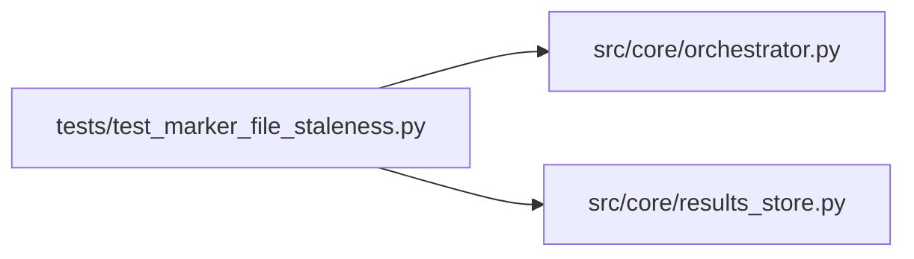

# test_marker_file_staleness Module

**Path:** `tests/test_marker_file_staleness.py`

## Description

_Auto-generated from `tests/test_marker_file_staleness.py`._

## Imports

| Source | Symbols |
|--------|---------|
| `__future__` | `annotations` |
| `anthropic` | `anthropic` |
| `os` | `os` |
| `pathlib` | `Path` |
| `pytest` | `pytest` |
| `src.core` | `orchestrator` |
| `src.core.orchestrator` | `AgentOrchestrator`, `ResearchConfig` |
| `src.core.results_store` | `ResultsStore` |
| `sys` | `sys` |
| `time` | `time` |
| `types` | `types`, `ModuleType` |
| `typing` | `cast` |

## Local dependency map

<!-- Auto-generated local dependency summary. Do not edit by hand. -->

### Internal neighbors

| Direction | Module |
|---|---|
| Outbound | [orchestrator](../modules/orchestrator.md) |
| Outbound | [results_store](../modules/results_store.md) |

### External packages

| Language | Used packages | Undeclared packages |
|---|---:|---:|
| python | 2 | 2 |

## Functions

| Function | Signature | Decorators | Description |
|----------|-----------|------------|-------------|
| `test_stale_marker_is_ignored_when_min_mtime_in_future` | *(async)* `(tmp_path: Path, monkeypatch: pytest.MonkeyPatch) -> None` | `@pytest.mark.asyncio` | — |
| `test_fresh_marker_is_consumed_when_min_mtime_in_past` | *(async)* `(tmp_path: Path, monkeypatch: pytest.MonkeyPatch) -> None` | `@pytest.mark.asyncio` | — |
| `test_marker_read_without_min_mtime_preserves_legacy_behavior` | *(async)* `(tmp_path: Path, monkeypatch: pytest.MonkeyPatch) -> None` | `@pytest.mark.asyncio` | — |
