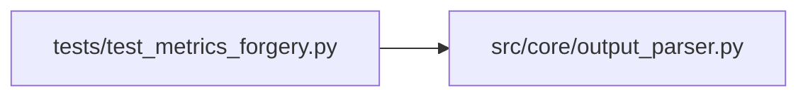

# test_metrics_forgery Module

**Path:** `tests/test_metrics_forgery.py`

## Description

P4-006 — Metrics forgery rejection tests (ARC-011 W11 anti-forgery).

Validates the ``_verify_nonce`` contract (P4-003/P4-005) through the
``JSONMarkerParser`` and ``DelimitedKVParser`` entry points:

* Forged marker (wrong nonce) → rejected (``None``).
* Forged marker (missing nonce) → rejected (``None``).
* Valid nonce → accepted with ``metrics_verification: "metrics_verified"``.
* Legacy session (no nonce, ``require_signed_metrics=True``) → graceful
  downgrade with ``"metrics_unverified"``.
* Default (``require_signed_metrics=False``) → accepted, **no** key added
  (parity preservation — the X-002 fixture shape is unchanged).

## Imports

| Source | Symbols |
|--------|---------|
| `__future__` | `annotations` |
| `json` | `json` |
| `src.core.output_parser` | `DelimitedKVParser`, `JSONMarkerParser` |

## Local dependency map

<!-- Auto-generated local dependency summary. Do not edit by hand. -->

### Internal neighbors

| Direction | Module |
|---|---|
| Outbound | [output_parser](../modules/output_parser.md) |

## Classes

| Class | Line | Bases | Description |
|-------|------|-------|-------------|
| [TestJSONMarkerParserForgery](../entities/TestJSONMarkerParserForgery.md) | 34 | — | — |
| [TestDelimitedKVParserForgery](../entities/TestDelimitedKVParserForgery.md) | 123 | — | — |

## Functions

| Function | Signature | Decorators | Description |
|----------|-----------|------------|-------------|
| `_marker` | `(nonce: str \| None = None, **extra: object) -> str` | — | Build an ``ITERATION_RESULT:`` JSON line with optional nonce. |
| `_kv_block` | `(nonce: str \| None = None) -> str` | — | Build a ``---`` delimited KV block with optional nonce. |
