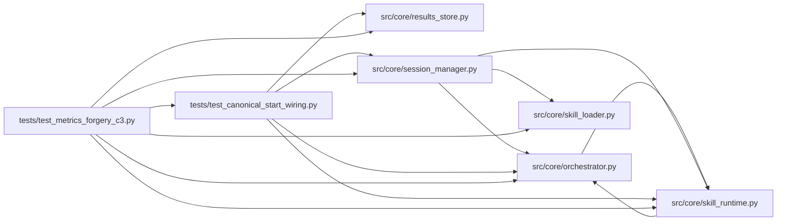

# test_metrics_forgery_c3 Module

**Path:** `tests/test_metrics_forgery_c3.py`

## Description

ARC-011 implementation review C3 (2026-08-15) — W11 anti-forgery fixes.

The review found the signed-metrics contract defeated by its own wiring:

* **KV-block bypass** — the ``---`` auto-detect path (and the marker-file
  path) called ``parse_prepare_output`` with no nonce argument, so any bash
  output containing a KV block was recorded as an iteration even for skills
  with ``require_signed_metrics=true``.
* **Silent KV forgeries** — the forged-detection branch only re-parsed
  marker-format blocks, so KV-format forgeries produced no
  ``metrics.forged`` audit.
* **Nonce readable by the adversary** — the nonce was embedded in the
  agent-readable workspace manifest artifact and injected into every
  governed subprocess env.
* **Non-constant-time compare** in ``_verify_nonce``.

These tests pin the fixes: ``_verify_kv_metrics`` (the shared verification
gate for both KV paths), ``_nonce_env_for_command`` (per-command env
narrowing), the runtime capability properties, and the out-of-band nonce.

## Imports

| Source | Symbols |
|--------|---------|
| `__future__` | `annotations` |
| `anthropic` | `anthropic` |
| `asyncio` | `asyncio` |
| `os` | `os` |
| `pathlib` | `Path` |
| `pytest` | `pytest` |
| `src.core.orchestrator` | `AgentOrchestrator`, `_nonce_env_for_command` |
| `src.core.results_store` | `ResultsStore` |
| `src.core.session_manager` | `session_manager_module` |
| `src.core.skill_loader` | `load_skill_manifest` |
| `src.core.skill_runtime` | `ManifestSkillRuntime` |
| `sys` | `sys` |
| `tests.test_canonical_start_wiring` | `FakeOrchestrator`, `_configure`, `_healthy_preflight` |
| `types` | `types`, `ModuleType` |
| `typing` | `Any`, `Dict`, `List`, `Optional`, `cast` |
| `unittest.mock` | `MagicMock` |

## Local dependency map

<!-- Auto-generated local dependency summary. Do not edit by hand. -->

### Internal neighbors

| Direction | Module |
|---|---|
| Outbound | [orchestrator](../modules/orchestrator.md) |
| Outbound | [results_store](../modules/results_store.md) |
| Outbound | [session_manager](../modules/session_manager.md) |
| Outbound | [skill_loader](../modules/skill_loader.md) |
| Outbound | [skill_runtime](../modules/skill_runtime.md) |
| Outbound | [test_canonical_start_wiring](../modules/test_canonical_start_wiring.md) |

### External packages

| Language | Used packages | Undeclared packages |
|---|---:|---:|
| python | 2 | 2 |

## Classes

| Class | Line | Bases | Description |
|-------|------|-------|-------------|
| [_FakeAgentLog](../entities/test_metrics_forgery_c3_FakeAgentLog.md) | 57 | — | — |
| [_AuditStore](../entities/AuditStore.md) | 65 | — | — |

## Functions

| Function | Signature | Decorators | Description |
|----------|-----------|------------|-------------|
| `_orch_with_store` | `(store: _AuditStore) -> AgentOrchestrator` | — | — |
| `_verify` | *(async)* `(result: Dict[str, Any], *, session_nonce: Optional[bytes], requires_signed: bool = True, source: str = 'bash_output') -> Optional[Dict[str, Any]]` | — | — |
| `test_kv_metrics_wrong_nonce_rejected_and_audited` | *(async)* `()` | — | A `---` block echoing the WRONG nonce is not recorded (previously the |
| `test_kv_metrics_missing_nonce_rejected_and_audited` | *(async)* `()` | — | — |
| `test_kv_metrics_correct_nonce_accepted` | *(async)* `()` | — | — |
| `test_kv_metrics_legacy_session_downgrades_gracefully` | *(async)* `()` | — | Enforced skill, but a legacy session with no nonce (P4-005): the |
| `test_kv_metrics_unenforced_passthrough_unchanged` | *(async)* `()` | — | Non-enforcing skills (all ML skills today): byte-identical legacy |
| `test_workspace_manifest_omits_nonce` | *(async)* `(monkeypatch, tmp_path)` | — | The review's exact leak: research_manifest.json (containing the |
| `test_nonce_env_none_when_not_built` | `()` | — | — |
| `test_nonce_env_only_for_declared_skill_scripts` | `()` | — | A governed command invoking one of the skill's manifest-declared |
| `test_requires_signed_metrics_capability_properties` | `()` | — | — |
