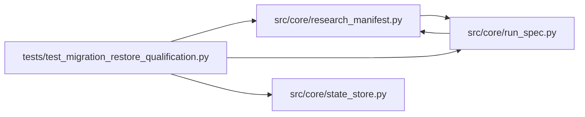

# test_migration_restore_qualification Module

**Path:** `tests/test_migration_restore_qualification.py`

## Description

Migration and restore qualification: upgraded databases keep their past.

Legacy databases upgrade to the current schema with rows, old manifests,
and artifact references preserved; backup and restore recover complete
state. These tests execute the same procedure the operational runbook
documents.

## Imports

| Source | Symbols |
|--------|---------|
| `__future__` | `annotations` |
| `aiosqlite` | `aiosqlite` |
| `json` | `json` |
| `pathlib` | `Path` |
| `pytest` | `pytest` |
| `sqlite3` | `sqlite3` |
| `src.core.research_manifest` | `load_persisted_manifest`, `build_research_manifest`, `build_research_manifest` |
| `src.core.run_spec` | `verify_run_spec`, `build_run_spec` |
| `src.core.state_store` | `_LATEST_SCHEMA_VERSION`, `_MIGRATIONS`, `_SCHEMA_SQL`, `SQLiteStateStore`, `_migrate_to_v1`, `_set_schema_version` |

## Local dependency map

<!-- Auto-generated local dependency summary. Do not edit by hand. -->

### Internal neighbors

| Direction | Module |
|---|---|
| Outbound | [research_manifest](../modules/research_manifest.md) |
| Outbound | [run_spec](../modules/run_spec.md) |
| Outbound | [state_store](../modules/state_store.md) |

### External packages

| Language | Used packages | Undeclared packages |
|---|---:|---:|
| python | 2 | 2 |

## Functions

| Function | Signature | Decorators | Description |
|----------|-----------|------------|-------------|
| `test_legacy_v1_database_upgrades_with_rows` | *(async)* `(tmp_path: Path)` | `@pytest.mark.asyncio` | — |
| `test_old_manifest_loads_with_its_provenance_reported` | *(async)* `(tmp_path: Path)` | `@pytest.mark.asyncio` | A pre-run-spec manifest loads as recorded: reported, never filled in. |
| `test_modern_artifact_references_survive_the_new_migrations` | *(async)* `(tmp_path: Path)` | `@pytest.mark.asyncio` | A pre-reservations database keeps its pinned artifact references. |
| `test_backup_and_restore_recovers_complete_state` | *(async)* `(tmp_path: Path)` | `@pytest.mark.asyncio` | The documented backup/restore procedure recovers every surface. |
