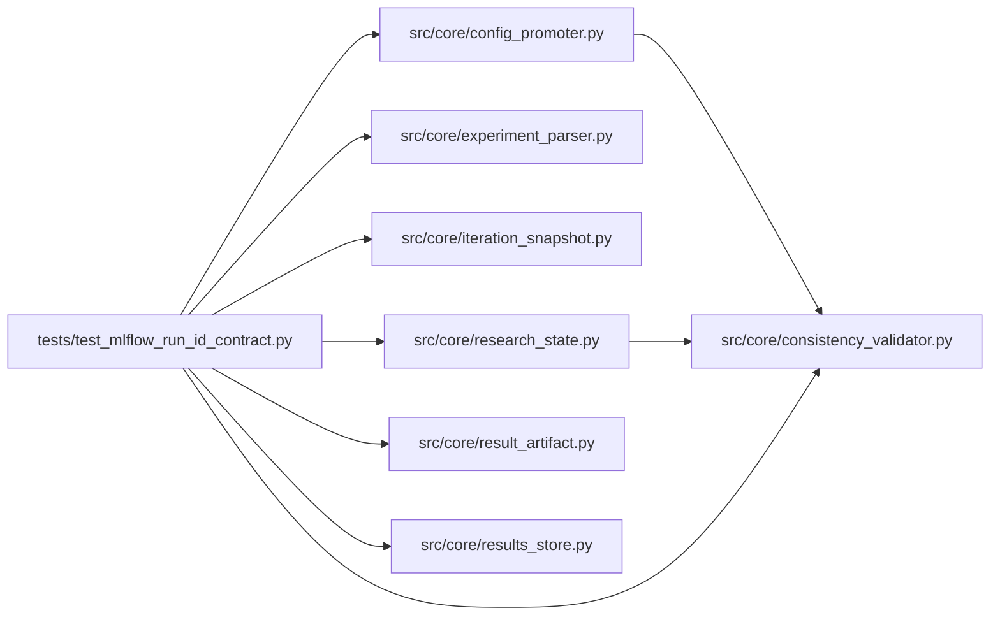

# test_mlflow_run_id_contract Module

**Path:** `tests/test_mlflow_run_id_contract.py`

## Description

_Auto-generated from `tests/test_mlflow_run_id_contract.py`._

## Imports

| Source | Symbols |
|--------|---------|
| `__future__` | `annotations` |
| `anthropic` | `anthropic` |
| `importlib.util` | `importlib.util` |
| `json` | `json` |
| `os` | `os` |
| `pathlib` | `Path` |
| `pytest` | `pytest` |
| `src.core` | `config_promoter` |
| `src.core.config_promoter` | `ConfigPromoter` |
| `src.core.consistency_validator` | `build_consistency_report` |
| `src.core.experiment_parser` | `parse_prepare_output` |
| `src.core.iteration_snapshot` | `build_iteration_attempt_snapshot` |
| `src.core.research_state` | `build_research_state` |
| `src.core.result_artifact` | `merge_result_payload` |
| `src.core.results_store` | `ResultsStore` |
| `sys` | `sys` |
| `types` | `types`, `ModuleType` |
| `typing` | `Any`, `Dict`, `cast` |

## Local dependency map

<!-- Auto-generated local dependency summary. Do not edit by hand. -->

### Internal neighbors

| Direction | Module |
|---|---|
| Outbound | [config_promoter](../modules/config_promoter.md) |
| Outbound | [consistency_validator](../modules/consistency_validator.md) |
| Outbound | [experiment_parser](../modules/experiment_parser.md) |
| Outbound | [iteration_snapshot](../modules/iteration_snapshot.md) |
| Outbound | [research_state](../modules/research_state.md) |
| Outbound | [result_artifact](../modules/result_artifact.md) |
| Outbound | [results_store](../modules/results_store.md) |

### External packages

| Language | Used packages | Undeclared packages |
|---|---:|---:|
| python | 2 | 2 |

## Functions

| Function | Signature | Decorators | Description |
|----------|-----------|------------|-------------|
| `_load_prepare_module` | `(relative_path: str, module_name: str)` | — | — |
| `_prepare_block` | `(mlflow_value: str) -> str` | — | — |
| `_create_session` | *(async)* `(store: ResultsStore, *, session_id: str, workspace: Path) -> None` | — | — |
| `test_parse_prepare_output_normalizes_mlflow_sentinels` | `() -> None` | — | — |
| `test_prepare_summaries_do_not_emit_literal_none` | `(capsys: pytest.CaptureFixture[str]) -> None` | — | — |
| `test_results_store_normalizes_mlflow_sentinel_values` | *(async)* `(tmp_path: Path) -> None` | `@pytest.mark.asyncio` | — |
| `test_snapshots_and_result_artifact_merge_drop_sentinel_references` | `(tmp_path: Path) -> None` | — | — |
| `test_consistency_report_blocks_mlflow_sentinel_artifact_reference` | `() -> None` | — | — |
| `test_consistency_report_accepts_immutable_result_artifact_reference` | `() -> None` | — | — |
