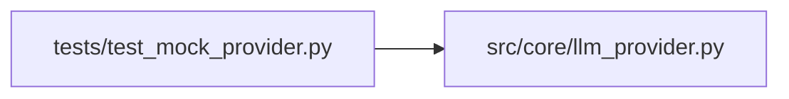

# test_mock_provider Module

**Path:** `tests/test_mock_provider.py`

## Description

MockProvider + demo-mode routing tests (P0-3).

Covers: the zero-credential scripted loop surface, the ``AUTORESEARCH_DEMO``
selector in ``build_provider``, and the production refusal (fail-closed).

## Imports

| Source | Symbols |
|--------|---------|
| `__future__` | `annotations` |
| `os` | `os` |
| `pytest` | `pytest` |
| `src.core.llm_provider` | `MockProvider`, `StopReason`, `Usage`, `build_provider`, `Message`, `TextBlock`, `ToolResultBlock`, `ToolUseBlock`, `Message`, `TextBlock`, `ToolResultBlock`, `ToolUseBlock`, `Message`, `TextBlock`, `ToolResultBlock`, `ToolUseBlock` |
| `types` | `SimpleNamespace` |

## Local dependency map

<!-- Auto-generated local dependency summary. Do not edit by hand. -->

### Internal neighbors

| Direction | Module |
|---|---|
| Outbound | [llm_provider](../modules/llm_provider.md) |

### External packages

| Language | Used packages | Undeclared packages |
|---|---:|---:|
| python | 1 | 1 |

## Functions

| Function | Signature | Decorators | Description |
|----------|-----------|------------|-------------|
| `_settings` | `(demo: bool, environment: str = 'development') -> SimpleNamespace` | — | — |
| `test_mock_provider_alternates_tool_and_text` | *(async)* `()` | `@pytest.mark.asyncio` | — |
| `test_mock_provider_relays_governed_eval_marker` | *(async)* `(monkeypatch)` | `@pytest.mark.asyncio` | ARC-012 P7-011: after a governed eval prints its iteration marker, the |
| `test_mock_provider_relay_only_from_newest_tool_result` | *(async)* `(monkeypatch)` | `@pytest.mark.asyncio` | Only the most recent tool result is scanned — a stale marker from an |
| `test_mock_provider_honors_custom_marker_prefix` | *(async)* `(monkeypatch)` | `@pytest.mark.asyncio` | — |
| `test_mock_provider_complete_and_cost` | *(async)* `()` | `@pytest.mark.asyncio` | — |
| `test_build_provider_demo_mode_routes_to_mock` | `()` | — | — |
| `test_build_provider_explicit_mock_id` | `()` | — | — |
| `test_build_provider_refuses_mock_in_production` | `()` | — | — |
| `test_build_provider_without_demo_stays_real` | `()` | — | — |
