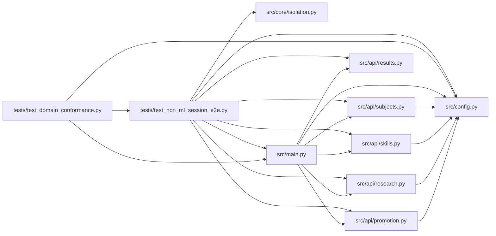

# test_non_ml_session_e2e Module

**Path:** `tests/test_non_ml_session_e2e.py`

## Description

ARC-012 P7-011 — the API-level non-ML end-to-end proof.

This is the test whose absence let blocker B1 (ARC-011 review C4 / P4-016:
"no non-ML session has ever run end-to-end") ship unnoticed. Unlike
``test_skill_prompt_engineering_e2e.py`` — which drives ``AgentOrchestrator``
directly, seeds the DB by hand, and builds ``ResearchConfig`` itself — this
suite exercises exactly the path a real operator hits:

    POST /api/v1/research/start (canonical skill_id shape, demo mode)
      → 201 → poll GET /research/{id} to a terminal state
      → GET /results + /iterations populate
      → POST /promote/preview reports the skill-appropriate target_kind

Everything between is the real machinery: the real app (lifespan wiring, real
``SessionManager``, real state store), the real skill bootstrap
(``BootstrapRunner`` renders the workspace), the real governed-command policy
(the eval subprocess runs under the skill's declared command policy with the
W11 nonce env), and the real marker-relay loop on the zero-credential
``MockProvider`` — no network anywhere (demo provider + offline evaluator).

The demo path P7-011 had to make real (each piece was previously dead):

* ``BootstrapRunner`` existed but had no production consumer — invoked here
  by ``SessionManager`` at session start (P7-011 implementation note).
* The mock provider's default eval command was skill-agnostic, relative-path,
  and never relayed the governed eval's ``ITERATION_RESULT`` marker — skills
  now declare ``prompt.demo_experiment_command`` (rendered with absolute
  ``{session_workspace}`` paths) and the mock relays the marker verbatim.

## Imports

| Source | Symbols |
|--------|---------|
| `__future__` | `annotations` |
| `fastapi.testclient` | `TestClient` |
| `os` | `os` |
| `pathlib` | `Path` |
| `pytest` | `pytest` |
| `src.api` | `promotion`, `research`, `results`, `skills`, `subjects` |
| `src.config` | `settings`, `get_settings` |
| `src.core.isolation` | `probe_host` |
| `src.main` | `app`, `main_module` |
| `sys` | `sys` |
| `time` | `time` |

## Local dependency map

<!-- Auto-generated local dependency summary. Do not edit by hand. -->

### Internal neighbors

| Direction | Module |
|---|---|
| Inbound | [test_domain_conformance](../modules/test_domain_conformance.md) |
| Outbound | [promotion](../modules/promotion.md) |
| Outbound | [research](../modules/research.md) |
| Outbound | [results](../modules/results.md) |
| Outbound | [src_api_skills](../modules/src_api_skills.md) |
| Outbound | [subjects](../modules/subjects.md) |
| Outbound | [config](../modules/config.md) |
| Outbound | [isolation](../modules/isolation.md) |
| Outbound | [src_main](../modules/src_main.md) |

### External packages

| Language | Used packages | Undeclared packages |
|---|---:|---:|
| python | 2 | 2 |

## Functions

| Function | Signature | Decorators | Description |
|----------|-----------|------------|-------------|
| `_auth` | `() -> dict[str, str]` | — | — |
| `_preserve_lifespan_globals` | `(monkeypatch: pytest.MonkeyPatch) -> None` | — | Snapshot the module globals main's lifespan wires so teardown restores |
| `demo_workspace` | `(monkeypatch: pytest.MonkeyPatch, tmp_path: Path)` | `@pytest.fixture` | A hermetic demo deployment: temp workspace root with the workspace |
| `_poll_terminal` | `(client: TestClient, research_id: str, timeout_s: float = 90.0) -> dict` | — | — |
| `_valid_params` | `(skill_id: str, staging_dir: Path) -> dict` | — | Per-skill parameter objects valid against each declared param_schema. |
| `test_non_ml_session_runs_end_to_end` | `(demo_workspace: Path, skill_id: str, expected_target_kind: str) -> None` | `@pytest.mark.parametrize(('skill_id', 'expected_target_kind'), _SKILL_CASES)` | — |
| `test_demo_workspace_bootstrap_files_exist` | `(demo_workspace: Path) -> None` | — | The start-path bootstrap (P7-011) renders the evaluator's inputs — |
