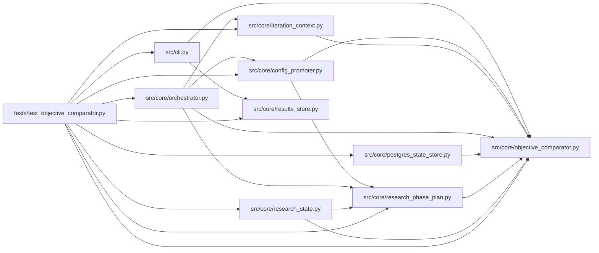

# test_objective_comparator Module

**Path:** `tests/test_objective_comparator.py`

## Description

Tests for the one objective comparator shared by every winner-selection path.

Contract: winner selection resolves a single comparator from the declared
objective (direction + declared epsilon) and every path compares through it.
Minimization and maximization select their own winners; ties within epsilon
preserve the existing eligible winner; absent/nonfinite metrics never win;
failed-gate rows are never promotable bests; ambiguous historical objective
data is flagged, never guessed.

## Imports

| Source | Symbols |
|--------|---------|
| `__future__` | `annotations` |
| `anthropic` | `anthropic` |
| `asyncpg` | `asyncpg` |
| `collections.abc` | `Mapping`, `Sequence` |
| `pytest` | `pytest` |
| `src.cli` | `build_parser`, `cmd_reconcile_bests` |
| `src.core.config_promoter` | `ConfigPromoter` |
| `src.core.iteration_context` | `_best_line` |
| `src.core.objective_comparator` | `ObjectiveComparator`, `ObjectiveContextError`, `objective_comparator_for_manifest`, `rank_rows`, `reconcile_historical_best`, `select_best_row`, `objective_comparator_for_skill_id` |
| `src.core.orchestrator` | `AgentOrchestrator`, `AgentOrchestrator`, `AgentOrchestrator` |
| `src.core.postgres_state_store` | `PostgresStateStore` |
| `src.core.research_phase_plan` | `_prior_best_metrics` |
| `src.core.research_state` | `_best_candidate_row` |
| `src.core.results_store` | `ResultsStore` |
| `sys` | `sys` |
| `types` | `types`, `ModuleType`, `SimpleNamespace` |
| `typing` | `Any`, `Dict`, `Optional`, `cast` |
| `uuid` | `uuid` |

## Local dependency map

<!-- Auto-generated local dependency summary. Do not edit by hand. -->

### Internal neighbors

| Direction | Module |
|---|---|
| Outbound | [cli](../modules/cli.md) |
| Outbound | [config_promoter](../modules/config_promoter.md) |
| Outbound | [iteration_context](../modules/iteration_context.md) |
| Outbound | [objective_comparator](../modules/objective_comparator.md) |
| Outbound | [orchestrator](../modules/orchestrator.md) |
| Outbound | [postgres_state_store](../modules/postgres_state_store.md) |
| Outbound | [research_phase_plan](../modules/research_phase_plan.md) |
| Outbound | [research_state](../modules/research_state.md) |
| Outbound | [results_store](../modules/results_store.md) |

### External packages

| Language | Used packages | Undeclared packages |
|---|---:|---:|
| python | 3 | 2 |

## Classes

| Class | Line | Bases | Description |
|-------|------|-------|-------------|
| [_FakeRegistry](../entities/FakeRegistry.md) | 53 | — | — |

## Functions

| Function | Signature | Decorators | Description |
|----------|-----------|------------|-------------|
| `_skill` | `(direction: str, field: str = 'primary_metric') -> SimpleNamespace` | — | — |
| `_seed_session` | *(async)* `(store: ResultsStore, research_id: str, *, best_iteration: Optional[int] = None, best_metric: Optional[float] = None) -> None` | — | — |
| `test_lower_metric_improves_and_higher_regresses_under_minimization` | `() -> None` | — | The minimization acceptance case: 100 -> 80 improves, 100 -> 120 regresses. |
| `test_maximization_behavior_remains_correct` | `() -> None` | — | — |
| `test_ties_within_epsilon_preserve_the_existing_eligible_winner` | `() -> None` | — | — |
| `test_exact_comparison_when_no_epsilon_is_declared` | `() -> None` | — | — |
| `test_declared_policy_tolerance_precedes_operational_epsilon` | `() -> None` | — | — |
| `test_absent_and_nonfinite_metrics_never_win` | `() -> None` | — | — |
| `test_unknown_objective_context_is_rejected_not_guessed` | `() -> None` | — | — |
| `test_manifest_vocabulary_maps_through_the_contract_bridge` | `() -> None` | — | — |
| `test_keep_discard_decision_honors_minimization` | *(async)* `(tmp_path) -> None` | `@pytest.mark.asyncio` | Under a minimize objective, 100 -> 80 keeps and 100 -> 120 discards. |
| `test_keep_discard_decision_honors_maximization` | *(async)* `(tmp_path) -> None` | `@pytest.mark.asyncio` | — |
| `_run_best_matrix` | *(async)* `(store: Any, rid: str) -> Dict[str, Any]` | — | Seed one minimization session and return every winner-selection view. |
| `test_sqlite_best_update_and_selection_honor_minimization` | *(async)* `(tmp_path) -> None` | `@pytest.mark.asyncio` | — |
| `test_best_selection_ties_keep_earliest_and_gates_are_eligible` | *(async)* `(tmp_path) -> None` | `@pytest.mark.asyncio` | — |
| `test_postgres_best_selection_matches_the_sqlite_matrix` | *(async)* `(tmp_path) -> None` | `@pytest.mark.asyncio` | Cross-store parity: Postgres picks the same winner as the SQLite matrix. |
| `test_stagnation_gap_tracks_the_direction_aware_best` | *(async)* `(tmp_path) -> None` | `@pytest.mark.asyncio` | — |
| `_baseline_row` | `(metric: float) -> Dict[str, Any]` | — | — |
| `_promotion_verdict` | *(async)* `(comparator: ObjectiveComparator, candidate: float, baseline: float) -> Dict[str, Any]` | — | — |
| `test_promotion_preview_blocks_minimization_regression` | *(async)* `() -> None` | `@pytest.mark.asyncio` | — |
| `test_promotion_preview_keeps_maximization_behavior` | *(async)* `() -> None` | `@pytest.mark.asyncio` | — |
| `test_ranking_orders_by_declared_direction_stably` | `() -> None` | — | — |
| `_historical_rows` | `() -> list[Dict[str, Any]]` | — | — |
| `test_reconciliation_uses_the_known_objective` | `() -> None` | — | — |
| `test_reconciliation_flags_ambiguous_objective_without_guessing` | `() -> None` | — | — |
| `test_reconciliation_reports_consistent_and_no_eligible` | `() -> None` | — | — |
| `test_reconcile_bests_command_reports_flags_and_applies` | *(async)* `(tmp_path, monkeypatch, capsys) -> None` | `@pytest.mark.asyncio` | — |
| `test_prior_best_selection_honors_direction` | `() -> None` | — | — |
| `test_production_champion_and_best_line_honor_direction` | `() -> None` | — | — |
| `test_legacy_model_type_alias_resolves_the_objective` | `(monkeypatch) -> None` | — | A legacy model_type session name is objective provenance, not a guess. |
