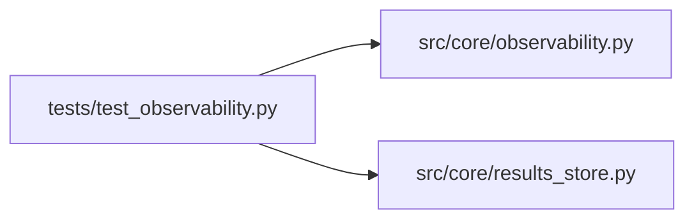

# test_observability Module

**Path:** `tests/test_observability.py`

## Description

_Auto-generated from `tests/test_observability.py`._

## Imports

| Source | Symbols |
|--------|---------|
| `__future__` | `annotations` |
| `json` | `json` |
| `logging` | `logging` |
| `pathlib` | `Path` |
| `pytest` | `pytest` |
| `src.core.observability` | `format_prometheus` |
| `src.core.results_store` | `ResultsStore` |

## Local dependency map

<!-- Auto-generated local dependency summary. Do not edit by hand. -->

### Internal neighbors

| Direction | Module |
|---|---|
| Outbound | [observability](../modules/observability.md) |
| Outbound | [results_store](../modules/results_store.md) |

### External packages

| Language | Used packages | Undeclared packages |
|---|---:|---:|
| python | 1 | 1 |

## Functions

| Function | Signature | Decorators | Description |
|----------|-----------|------------|-------------|
| `_create_rl_session` | *(async)* `(store: ResultsStore, tmp_path: Path) -> None` | — | — |
| `test_observability_snapshot_exports_prometheus_metrics` | *(async)* `(tmp_path: Path)` | `@pytest.mark.asyncio` | — |
| `test_structured_logs_include_research_trace_context` | *(async)* `(tmp_path: Path, caplog: pytest.LogCaptureFixture)` | `@pytest.mark.asyncio` | — |
