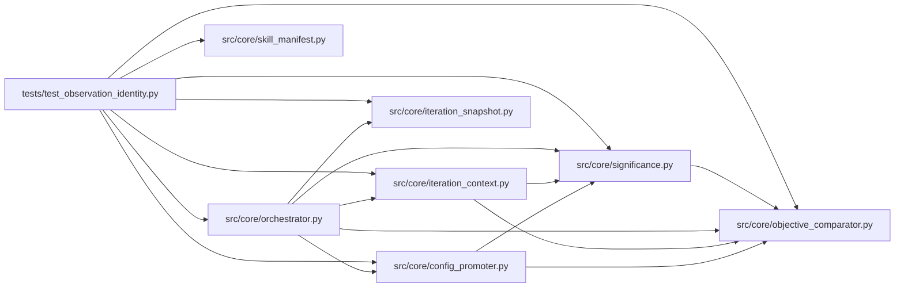

# test_observation_identity Module

**Path:** `tests/test_observation_identity.py`

## Description

Tests for candidate identity separated from repeated observations.

Contract: the candidate digest (what was attempted) stays separate from the
observation identity (which measured observation of that candidate). Declared
identity fields are honored; evaluation-context changes isolate observations;
authorized repeats carry distinct observation slots and are charged; accidental
duplicate deliveries never run twice; exploratory point estimates are visibly
separated from qualification requiring sample counts and holdouts.

## Imports

| Source | Symbols |
|--------|---------|
| `__future__` | `annotations` |
| `anthropic` | `anthropic` |
| `pydantic` | `ValidationError` |
| `pytest` | `pytest` |
| `src.core.config_promoter` | `ConfigPromoter` |
| `src.core.iteration_context` | `build_iteration_context_digest` |
| `src.core.iteration_snapshot` | `UnsupportedIdentityResolveError`, `build_trial_identity`, `evaluation_context_hash`, `trial_identity_hash` |
| `src.core.objective_comparator` | `ObjectiveComparator` |
| `src.core.orchestrator` | `ResearchConfig`, `AgentOrchestrator` |
| `src.core.significance` | `INCONCLUSIVE`, `SIGNIFICANT`, `qualification_status`, `samples_from_rows`, `significance_verdict` |
| `src.core.skill_manifest` | `SignificanceConfig` |
| `sys` | `sys` |
| `types` | `types`, `ModuleType`, `SimpleNamespace` |
| `typing` | `Any`, `Dict`, `Optional`, `cast` |

## Local dependency map

<!-- Auto-generated local dependency summary. Do not edit by hand. -->

### Internal neighbors

| Direction | Module |
|---|---|
| Outbound | [config_promoter](../modules/config_promoter.md) |
| Outbound | [iteration_context](../modules/iteration_context.md) |
| Outbound | [iteration_snapshot](../modules/iteration_snapshot.md) |
| Outbound | [objective_comparator](../modules/objective_comparator.md) |
| Outbound | [orchestrator](../modules/orchestrator.md) |
| Outbound | [significance](../modules/significance.md) |
| Outbound | [skill_manifest](../modules/skill_manifest.md) |

### External packages

| Language | Used packages | Undeclared packages |
|---|---:|---:|
| python | 3 | 2 |

## Classes

| Class | Line | Bases | Description |
|-------|------|-------|-------------|
| [_DupStore](../entities/DupStore.md) | 220 | — | — |

## Functions

| Function | Signature | Decorators | Description |
|----------|-----------|------------|-------------|
| `_identity` | `(*, hash_fields: Optional[list] = None, marker: Optional[Dict[str, Any]] = None, evaluation_context: Optional[Dict[str, Any]] = None, repeat_index: Optional[int] = None, config_snapshot: str = 'a: 1\n') -> Dict[str, Any]` | — | — |
| `test_declared_hash_fields_select_the_observation_identity` | `() -> None` | — | — |
| `test_legacy_identity_unchanged_without_declarations` | `() -> None` | — | — |
| `test_plugin_resolver_is_rejected_explicitly` | `() -> None` | — | — |
| `test_evaluation_context_hash_covers_evaluator_data_environment_fidelity` | `() -> None` | — | — |
| `test_changed_evaluation_context_isolates_observations` | `() -> None` | — | — |
| `_guard_config` | `(**overrides: Any)` | — | — |
| `_skill_with_policy` | `(*, planned_repeats: int = 2, hash_fields: Optional[list] = None) -> SimpleNamespace` | — | — |
| `_run_guard` | *(async)* `(*, duplicate: Optional[Dict[str, Any]], planned_trial: Dict[str, Any], skill: Optional[SimpleNamespace] = None)` | — | — |
| `test_authorized_repeats_get_distinct_observation_identities` | *(async)* `() -> None` | `@pytest.mark.asyncio` | — |
| `test_repeat_slots_stay_distinct_and_resubmission_collides` | `() -> None` | — | — |
| `test_duplicate_delivery_does_not_run_twice` | *(async)* `() -> None` | `@pytest.mark.asyncio` | — |
| `test_repeats_beyond_the_declaration_are_rejected_explicitly` | *(async)* `() -> None` | `@pytest.mark.asyncio` | — |
| `test_unsupported_identity_resolver_fails_before_work` | *(async)* `() -> None` | `@pytest.mark.asyncio` | — |
| `_noisy_seeded_samples` | `() -> tuple[list, list]` | — | Deterministic noisy multi-seed fixture (seeded LCG, no RNG dependency). |
| `test_noisy_fixture_falls_back_visibly_and_never_qualifies` | `() -> None` | — | — |
| `test_sample_counts_and_holdouts_gate_qualification` | `() -> None` | — | — |
| `test_manifest_declares_the_repeat_policy` | `() -> None` | — | — |
| `test_inconclusive_significance_cannot_silently_qualify_production` | *(async)* `(monkeypatch) -> None` | `@pytest.mark.asyncio` | — |
| `test_context_digest_states_the_significance_fallback` | *(async)* `(monkeypatch) -> None` | `@pytest.mark.asyncio` | — |
