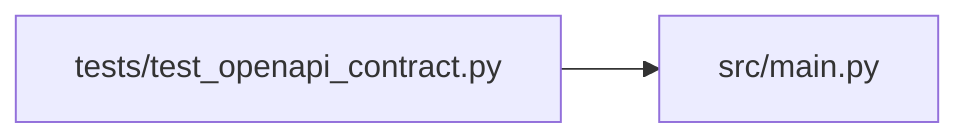

# test_openapi_contract Module

**Path:** `tests/test_openapi_contract.py`

## Description

_Auto-generated from `tests/test_openapi_contract.py`._

## Imports

| Source | Symbols |
|--------|---------|
| `__future__` | `annotations` |
| `json` | `json` |
| `pathlib` | `Path` |
| `src` | `main` |
| `yaml` | `yaml` |

## Local dependency map

<!-- Auto-generated local dependency summary. Do not edit by hand. -->

### Internal neighbors

| Direction | Module |
|---|---|
| Outbound | [src_main](../modules/src_main.md) |

### External packages

| Language | Used packages | Undeclared packages |
|---|---:|---:|
| python | 1 | 0 |

## Functions

| Function | Signature | Decorators | Description |
|----------|-----------|------------|-------------|
| `_schema` | `() -> dict` | — | — |
| `test_static_openapi_yaml_matches_app_schema` | `() -> None` | — | The committed openapi.yaml must stay in sync with the app's schema. |
| `test_openapi_prefers_api_v1_and_hides_legacy_api_prefix` | `() -> None` | — | — |
| `test_openapi_documents_auth_and_idempotency_headers` | `() -> None` | — | — |
| `test_openapi_documents_promotion_approval_schema` | `() -> None` | — | — |
| `test_openapi_documents_health_info_and_excludes_metrics` | `() -> None` | — | — |
| `test_checked_openapi_yaml_matches_app_schema` | `() -> None` | — | — |
