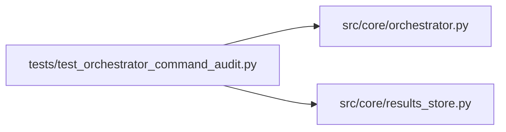

# test_orchestrator_command_audit Module

**Path:** `tests/test_orchestrator_command_audit.py`

## Description

_Auto-generated from `tests/test_orchestrator_command_audit.py`._

## Imports

| Source | Symbols |
|--------|---------|
| `__future__` | `annotations` |
| `anthropic` | `anthropic` |
| `pathlib` | `Path` |
| `pytest` | `pytest` |
| `src.core.orchestrator` | `AgentOrchestrator`, `ResearchConfig` |
| `src.core.results_store` | `ResultsStore` |
| `sys` | `sys` |
| `types` | `types` |

## Local dependency map

<!-- Auto-generated local dependency summary. Do not edit by hand. -->

### Internal neighbors

| Direction | Module |
|---|---|
| Outbound | [orchestrator](../modules/orchestrator.md) |
| Outbound | [results_store](../modules/results_store.md) |

### External packages

| Language | Used packages | Undeclared packages |
|---|---:|---:|
| python | 2 | 2 |

## Classes

| Class | Line | Bases | Description |
|-------|------|-------|-------------|
| [_FakeAsyncAnthropic](../entities/test_orchestrator_command_audit_FakeAsyncAnthropic.md) | 12 | — | — |
| [_FakeAPIStatusError](../entities/test_orchestrator_command_audit_FakeAPIStatusError.md) | 16 | `Exception` | — |

## Functions

| Function | Signature | Decorators | Description |
|----------|-----------|------------|-------------|
| `test_orchestrator_records_command_policy_rejection_audit` | *(async)* `(tmp_path: Path)` | `@pytest.mark.asyncio` | — |
| `test_record_iteration_refreshes_effective_iteration_count` | *(async)* `(tmp_path: Path)` | `@pytest.mark.asyncio` | — |
