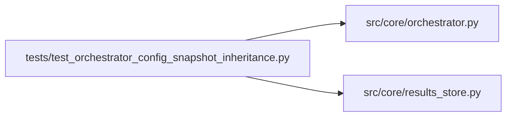

# test_orchestrator_config_snapshot_inheritance Module

**Path:** `tests/test_orchestrator_config_snapshot_inheritance.py`

## Description

AR-3: Tests for auto-inheritance of config_snapshot on promotion-family phases.

Defect D4: during phases that validate/replay/promote an already-trained
artefact (multi_seed_robustness, inference_parity_replay,
calibration_replay_gates, promotion_proposal) the agent legitimately emits
no config_snapshot in the iteration marker because it never runs a fresh
training command.  The consistency validator always flags this as
``missing_config_snapshot``, making ``passed: False``.

Fix: ``_record_iteration`` now detects when the active phase is in
``_PROMOTION_FAMILY`` and the marker has no config_snapshot.  It then
queries ``get_latest_iteration_with_config_snapshot`` and inherits the
result, recording the source iteration number in
``config_snapshot_inherited_from_iteration`` for audit purposes.

## Imports

| Source | Symbols |
|--------|---------|
| `__future__` | `annotations` |
| `anthropic` | `anthropic` |
| `json` | `json` |
| `pathlib` | `Path` |
| `pytest` | `pytest` |
| `src.core.orchestrator` | `AgentOrchestrator` |
| `src.core.results_store` | `ResultsStore` |
| `sys` | `sys` |
| `types` | `types` |
| `typing` | `Any`, `Dict` |

## Local dependency map

<!-- Auto-generated local dependency summary. Do not edit by hand. -->

### Internal neighbors

| Direction | Module |
|---|---|
| Outbound | [orchestrator](../modules/orchestrator.md) |
| Outbound | [results_store](../modules/results_store.md) |

### External packages

| Language | Used packages | Undeclared packages |
|---|---:|---:|
| python | 2 | 2 |

## Functions

| Function | Signature | Decorators | Description |
|----------|-----------|------------|-------------|
| `_create_session` | *(async)* `(store: ResultsStore, *, session_id: str) -> None` | — | — |
| `_keep_marker` | `(config_snapshot: str) -> Dict[str, Any]` | — | Realistic 'keep' iteration marker that carries a config_snapshot. |
| `_promotion_marker` | `(phase: str) -> Dict[str, Any]` | — | Promotion-family marker with no config_snapshot (the D4 scenario). |
| `test_get_latest_iteration_with_config_snapshot_returns_most_recent` | *(async)* `(tmp_path: Path) -> None` | `@pytest.mark.asyncio` | Basic happy-path: returns the highest-numbered iteration that has a snapshot. |
| `test_get_latest_iteration_with_config_snapshot_returns_none_when_all_null` | *(async)* `(tmp_path: Path) -> None` | `@pytest.mark.asyncio` | When every iteration has config_snapshot=NULL, the method returns None. |
| `test_get_latest_iteration_with_config_snapshot_returns_none_for_empty_session` | *(async)* `(tmp_path: Path) -> None` | `@pytest.mark.asyncio` | Empty session (no iterations at all) → None, no error. |
| `test_promotion_iteration_inherits_config_snapshot_from_previous_keep` | *(async)* `(tmp_path: Path) -> None` | `@pytest.mark.asyncio` | AR-3 core: promotion_proposal iter inherits iter-1 snapshot. |
| `test_promotion_iteration_inherits_from_most_recent_snapshot` | *(async)* `(tmp_path: Path) -> None` | `@pytest.mark.asyncio` | Inheritance picks the HIGHEST-numbered iteration, not the first one. |
| `test_inheritance_not_applied_when_outside_promotion_family` | *(async)* `(tmp_path: Path) -> None` | `@pytest.mark.asyncio` | tabular_sweeps is not in _PROMOTION_FAMILY: no inheritance occurs. |
| `test_inheritance_not_applied_when_no_previous_snapshot_exists` | *(async)* `(tmp_path: Path) -> None` | `@pytest.mark.asyncio` | If no prior iteration has a snapshot, inheritance silently does nothing. |
| `test_consistency_report_passes_after_inheritance` | *(async)* `(tmp_path: Path) -> None` | `@pytest.mark.asyncio` | AR-3 acceptance: after inheritance the consistency report has no |
| `test_all_promotion_family_phases_trigger_inheritance` | *(async)* `(tmp_path: Path) -> None` | `@pytest.mark.asyncio` | Every phase in _PROMOTION_FAMILY must trigger inheritance. |
| `test_existing_config_snapshot_not_overwritten` | *(async)* `(tmp_path: Path) -> None` | `@pytest.mark.asyncio` | A promotion-family iter that already has a config_snapshot keeps its own. |
| `test_phase_from_session_phase_state_json_also_triggers_inheritance` | *(async)* `(tmp_path: Path) -> None` | `@pytest.mark.asyncio` | Inheritance fires when active phase comes from session.phase_state_json. |
| `test_attach_consistency_report_persists_resolved_search_phase` | *(async)* `(tmp_path: Path) -> None` | `@pytest.mark.asyncio` | Explicit iteration overwrites keep the phase column in sync. |
