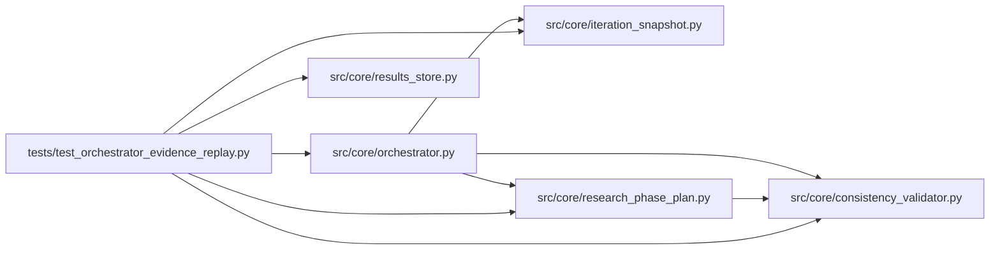

# test_orchestrator_evidence_replay Module

**Path:** `tests/test_orchestrator_evidence_replay.py`

## Description

DM-1 — evidence-replay link on a session-best dedup hit.

Iterations 8/10/11/12 of res_be66790e192e re-ran the iteration-7 best
config across calibration_replay_gates, multi_seed_robustness, and
inference_parity_replay — four wasted ~7-minute re-trains for a metric
that was already on disk. The orchestrator must, on a dedup hit where
(a) the canonical config matches the session's best and (b) the active
phase is in ``EVIDENCE_INHERITABLE_PHASES``, synthesise a marker that
inherits the prior iteration's phase-advancement evidence and skip the
training command altogether.

Mirrors the noop-inheritance test (``test_phase_evidence_dedup_inherit.py``)
in structure; the differences are the inheritable phase set and the
audit-field name (``evidence_replayed_from_iteration``).

## Imports

| Source | Symbols |
|--------|---------|
| `__future__` | `annotations` |
| `anthropic` | `anthropic` |
| `json` | `json` |
| `os` | `os` |
| `pathlib` | `Path` |
| `pytest` | `pytest` |
| `src.core.consistency_validator` | `_is_synthetic_promotion_iteration` |
| `src.core.iteration_snapshot` | `build_trial_identity`, `trial_identity_hash` |
| `src.core.orchestrator` | `AgentOrchestrator`, `ResearchConfig` |
| `src.core.research_phase_plan` | `EVIDENCE_INHERITABLE_PHASES`, `build_phase_state` |
| `src.core.results_store` | `ResultsStore` |
| `sys` | `sys` |
| `types` | `types` |

## Local dependency map

<!-- Auto-generated local dependency summary. Do not edit by hand. -->

### Internal neighbors

| Direction | Module |
|---|---|
| Outbound | [consistency_validator](../modules/consistency_validator.md) |
| Outbound | [iteration_snapshot](../modules/iteration_snapshot.md) |
| Outbound | [orchestrator](../modules/orchestrator.md) |
| Outbound | [research_phase_plan](../modules/research_phase_plan.md) |
| Outbound | [results_store](../modules/results_store.md) |

### External packages

| Language | Used packages | Undeclared packages |
|---|---:|---:|
| python | 2 | 2 |

## Functions

| Function | Signature | Decorators | Description |
|----------|-----------|------------|-------------|
| `_identity_hash` | `()` | — | — |
| `_new_store` | *(async)* `(tmp_path: Path) -> ResultsStore` | — | — |
| `_create_session` | *(async)* `(store: ResultsStore, sid: str, ws: Path) -> None` | — | — |
| `_seed_best_iteration` | *(async)* `(store: ResultsStore, *, sid: str, iteration: int, search_phase: str, advancement_payload: dict) -> None` | — | Seed the canonical session-best iteration with phase-advancement |
| `test_dedup_in_inheritable_phase_replays_best_evidence` | *(async)* `(tmp_path: Path) -> None` | `@pytest.mark.asyncio` | — |
| `test_synthetic_iteration_guard_whitelists_evidence_replay` | `() -> None` | — | — |
| `test_synthetic_iteration_guard_still_flags_unrelated_synthetic` | `() -> None` | — | Regression: a marker without the evidence-replay sentinel that |
| `test_replay_branch_does_not_fire_when_config_hash_differs` | *(async)* `(tmp_path: Path) -> None` | `@pytest.mark.asyncio` | — |
| `test_evidence_inheritable_phases_locked` | `() -> None` | — | — |
