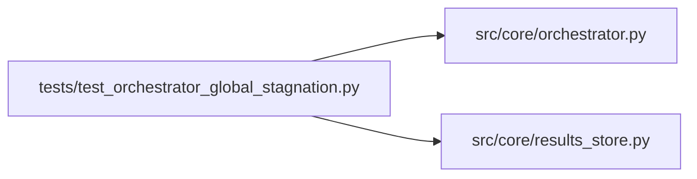

# test_orchestrator_global_stagnation Module

**Path:** `tests/test_orchestrator_global_stagnation.py`

## Description

AR-7: Tests for _maybe_global_stagnation_terminate.

Defect D7: Sessions with no metric improvement for many consecutive iterations
kept running experiments until max_iterations or budget was exhausted, with no
prompt to the LLM to terminate gracefully.

Fix: after each tool-call round, the orchestrator calls
``_maybe_global_stagnation_terminate``.  When the session's
``best_iteration`` is more than ``settings.global_stagnation_window``
iterations behind the current iteration count, a ``GLOBAL_STAGNATION`` system
message is injected into ``tool_results`` demanding a ``TERMINATE_REQUEST:``.

## Imports

| Source | Symbols |
|--------|---------|
| `__future__` | `annotations` |
| `anthropic` | `anthropic` |
| `json` | `_json`, `_json`, `_json` |
| `pathlib` | `Path` |
| `pytest` | `pytest` |
| `src.core.orchestrator` | `AgentOrchestrator`, `ResearchConfig`, `orch_module`, `orch_module`, `orch_module` |
| `src.core.results_store` | `ResultsStore` |
| `sys` | `sys` |
| `types` | `types`, `ModuleType` |
| `typing` | `Any`, `Dict`, `Optional`, `cast` |

## Local dependency map

<!-- Auto-generated local dependency summary. Do not edit by hand. -->

### Internal neighbors

| Direction | Module |
|---|---|
| Outbound | [orchestrator](../modules/orchestrator.md) |
| Outbound | [results_store](../modules/results_store.md) |

### External packages

| Language | Used packages | Undeclared packages |
|---|---:|---:|
| python | 2 | 2 |

## Functions

| Function | Signature | Decorators | Description |
|----------|-----------|------------|-------------|
| `_make_config` | `(research_id: str) -> ResearchConfig` | — | — |
| `_seed_session` | *(async)* `(store: ResultsStore, research_id: str, *, best_iteration: Optional[int] = None, best_metric: Optional[float] = None) -> None` | — | — |
| `test_global_stagnation_injects_terminate_warning_after_window` | *(async)* `(tmp_path: Path) -> None` | `@pytest.mark.asyncio` | AR-7 core: stagnation nudge fires after global_stagnation_window iterations. |
| `test_global_stagnation_does_not_fire_before_window` | *(async)* `(tmp_path: Path) -> None` | `@pytest.mark.asyncio` | AR-7: no nudge when gap < window (still within improvement horizon). |
| `test_global_stagnation_resets_after_metric_improvement` | *(async)* `(tmp_path: Path) -> None` | `@pytest.mark.asyncio` | AR-7: window re-arms from the new best_iteration after improvement. |
| `test_global_stagnation_window_configurable` | *(async)* `(tmp_path: Path, monkeypatch: pytest.MonkeyPatch) -> None` | `@pytest.mark.asyncio` | AR-7: global_stagnation_window is read from settings; override via monkeypatch. |
| `test_global_stagnation_epsilon_prevents_tiny_best_reset` | *(async)* `(tmp_path: Path, monkeypatch: pytest.MonkeyPatch) -> None` | `@pytest.mark.asyncio` | Improvements <= epsilon must not reset best_iteration. |
| `test_global_stagnation_epsilon_allows_real_best_reset` | *(async)* `(tmp_path: Path, monkeypatch: pytest.MonkeyPatch) -> None` | `@pytest.mark.asyncio` | Improvements > epsilon reset best_iteration and delay the nudge. |
| `test_global_stagnation_no_fire_when_no_best_iteration` | *(async)* `(tmp_path: Path) -> None` | `@pytest.mark.asyncio` | AR-7: conservative — no nudge when session has no best_iteration yet. |
| `test_global_stagnation_fires_exactly_at_window_boundary` | *(async)* `(tmp_path: Path) -> None` | `@pytest.mark.asyncio` | AR-7: exactly gap == window is the first trigger point (>= boundary). |
| `test_global_stagnation_does_not_fire_in_exempt_phase` | *(async)* `(tmp_path: Path) -> None` | `@pytest.mark.asyncio` | Phase-aware guard: stagnation must NOT fire when current_phase is exempt |
| `test_global_stagnation_fires_in_auto_evidence_only_exempt_phase` | *(async)* `(tmp_path: Path) -> None` | `@pytest.mark.asyncio` | Fix 5: when the only iterations in the exempt phase are |
| `test_global_stagnation_fires_in_non_exempt_phase` | *(async)* `(tmp_path: Path) -> None` | `@pytest.mark.asyncio` | Phase-aware guard: stagnation MUST still fire in hyperparameter-tuning phases. |
