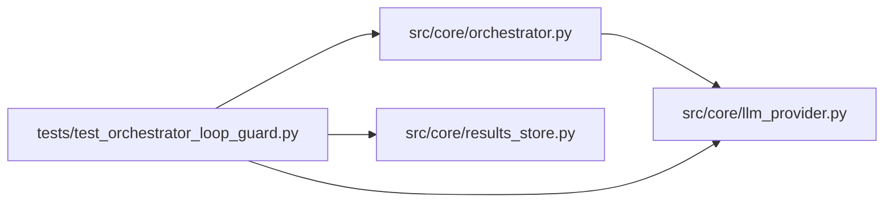

# test_orchestrator_loop_guard Module

**Path:** `tests/test_orchestrator_loop_guard.py`

## Description

AR-4: Tests for _build_phase_continuation_kick blocked-phase handling.

Defect D5: when the terminal phase (``promotion_proposal``) is in a
``blocked`` state — e.g., because a consistency gate raised
``missing_config_snapshot`` — ``_build_phase_continuation_kick`` emitted the
same generic phase-continuation text with no escalation.  The LLM received
the same nudge 7+ times and spun without progress, burning budget.

Fix: the kick now:
  1. Detects ``state["blocked"] == True`` separately from ``incomplete``.
  2. Counts per-block_reason attempts for each research session via
     ``AgentOrchestrator._blocker_attempt_counters``.
  3. On the first and second attempt: returns ``reason="blocker_remediation"``
     with targeted text naming the active blocker.
  4. On the 3rd (and subsequent) attempts: returns
     ``reason="blocker_unresolved_terminate"`` with text beginning
     ``BLOCKER_PERSISTED:`` to force a ``TERMINATE_REQUEST`` from the LLM.
  5. When every phase is ``completed`` AND ``blocked`` is False: returns
     ``None`` (honours end_turn).

## Imports

| Source | Symbols |
|--------|---------|
| `__future__` | `annotations` |
| `anthropic` | `anthropic` |
| `json` | `json` |
| `pathlib` | `Path` |
| `pytest` | `pytest` |
| `src.core` | `orchestrator` |
| `src.core.llm_provider` | `ProviderResponse`, `StopReason`, `TextBlock`, `Usage` |
| `src.core.orchestrator` | `AgentOrchestrator`, `ResearchConfig` |
| `src.core.results_store` | `ResultsStore` |
| `sys` | `sys` |
| `types` | `types`, `ModuleType` |
| `typing` | `Any`, `Dict`, `cast` |
| `unittest.mock` | `AsyncMock`, `patch` |

## Local dependency map

<!-- Auto-generated local dependency summary. Do not edit by hand. -->

### Internal neighbors

| Direction | Module |
|---|---|
| Outbound | [llm_provider](../modules/llm_provider.md) |
| Outbound | [orchestrator](../modules/orchestrator.md) |
| Outbound | [results_store](../modules/results_store.md) |

### External packages

| Language | Used packages | Undeclared packages |
|---|---:|---:|
| python | 2 | 2 |

## Functions

| Function | Signature | Decorators | Description |
|----------|-----------|------------|-------------|
| `_make_config` | `(research_id: str) -> ResearchConfig` | — | — |
| `_seed_session` | *(async)* `(store: ResultsStore, research_id: str) -> None` | — | — |
| `_blocked_terminal_state` | `(block_reason: str = 'missing_config_snapshot') -> Dict[str, Any]` | — | A phase state where all non-terminal phases are completed but |
| `_all_completed_state` | `() -> Dict[str, Any]` | — | All phases completed, no blocker — phase plan is genuinely done. |
| `_incomplete_normal_state` | `() -> Dict[str, Any]` | — | Some phases still pending, no blocker — standard continuation kick. |
| `_fake_text_response` | `(text: str) -> Any` | — | — |
| `test_extract_terminate_request_detects_assistant_line` | `() -> None` | — | — |
| `test_extract_terminate_request_ignores_instruction_mentions` | `() -> None` | — | — |
| `test_run_honors_terminate_request_without_phase_kick` | *(async)* `(tmp_path: Path) -> None` | `@pytest.mark.asyncio` | Assistant TERMINATE_REQUEST is accepted even with incomplete phases. |
| `test_phase_kick_returns_none_when_all_phases_completed` | *(async)* `(tmp_path: Path) -> None` | `@pytest.mark.asyncio` | When every phase is completed and not blocked, kick returns None. |
| `test_phase_kick_returns_standard_kick_when_incomplete_not_blocked` | *(async)* `(tmp_path: Path) -> None` | `@pytest.mark.asyncio` | Non-blocked incomplete phases → standard 'phase_continuation' reason. |
| `test_phase_kick_returns_blocker_remediation_on_first_attempt` | *(async)* `(tmp_path: Path) -> None` | `@pytest.mark.asyncio` | AR-4 D5 first attempt: blocked terminal phase → reason='blocker_remediation'. |
| `test_phase_kick_escalates_to_terminate_after_three_blocker_attempts` | *(async)* `(tmp_path: Path) -> None` | `@pytest.mark.asyncio` | AR-4 D5 escalation: same block_reason after 3 attempts → forced terminate. |
| `test_phase_kick_counter_is_keyed_by_block_reason` | *(async)* `(tmp_path: Path) -> None` | `@pytest.mark.asyncio` | Switching to a different block_reason resets the escalation counter. |
| `test_phase_kick_returns_none_when_budget_exhausted_despite_blocker` | *(async)* `(tmp_path: Path) -> None` | `@pytest.mark.asyncio` | Even when the phase is blocked, if budget is ≤ $0.10 the kick returns None. |
| `test_phase_kick_counter_cleaned_up_in_finally` | *(async)* `(tmp_path: Path) -> None` | `@pytest.mark.asyncio` | _blocker_attempt_counters is cleaned up after a session ends. |
