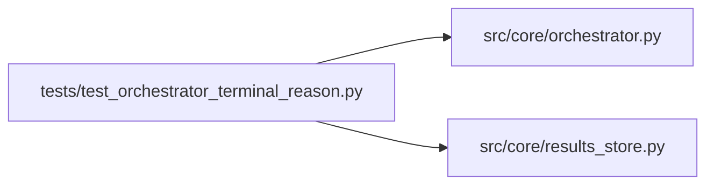

# test_orchestrator_terminal_reason Module

**Path:** `tests/test_orchestrator_terminal_reason.py`

## Description

AR-2: Tests for structured terminal_reason on the exception path.

Defect D2: when the agent loop crashes with an unhandled exception the
``except Exception`` handler wrote ``status="failed"`` but no
``terminal_reason``, leaving the column NULL in the database.  This
defeats the F9 audit-trail and makes postmortem filtering impossible.

Fix: the handler now writes
  ``terminal_reason = f"error_unrecoverable:{type(exc).__name__}"``
before calling ``update_session``.

## Imports

| Source | Symbols |
|--------|---------|
| `__future__` | `annotations` |
| `anthropic` | `anthropic` |
| `asyncio` | `asyncio` |
| `pathlib` | `Path` |
| `pytest` | `pytest` |
| `src.core` | `orchestrator` |
| `src.core.orchestrator` | `AgentOrchestrator`, `ResearchConfig` |
| `src.core.results_store` | `ResultsStore` |
| `sys` | `sys` |
| `types` | `types`, `ModuleType` |
| `typing` | `cast` |
| `unittest.mock` | `AsyncMock`, `MagicMock`, `patch` |

## Local dependency map

<!-- Auto-generated local dependency summary. Do not edit by hand. -->

### Internal neighbors

| Direction | Module |
|---|---|
| Outbound | [orchestrator](../modules/orchestrator.md) |
| Outbound | [results_store](../modules/results_store.md) |

### External packages

| Language | Used packages | Undeclared packages |
|---|---:|---:|
| python | 2 | 2 |

## Functions

| Function | Signature | Decorators | Description |
|----------|-----------|------------|-------------|
| `_make_config` | `(research_id: str, workspace: str) -> ResearchConfig` | — | — |
| `_seed_session` | *(async)* `(store: ResultsStore, config: ResearchConfig) -> None` | — | Create the session row that ``run()`` expects to already exist. |
| `test_run_failure_writes_terminal_reason_error_unrecoverable` | *(async)* `(tmp_path: Path) -> None` | `@pytest.mark.asyncio` | AR-2 core: crash inside the try block writes terminal_reason. |
| `test_run_failure_preserves_exc_class_name_for_different_exception_types` | *(async)* `(tmp_path: Path) -> None` | `@pytest.mark.asyncio` | terminal_reason class suffix must match the actual exception type. |
| `test_cancelled_error_does_not_write_terminal_reason` | *(async)* `(tmp_path: Path) -> None` | `@pytest.mark.asyncio` | asyncio.CancelledError path must NOT write terminal_reason. |
| `test_run_failure_error_message_truncated_at_2000_chars` | *(async)* `(tmp_path: Path) -> None` | `@pytest.mark.asyncio` | error_message is truncated to 2000 chars to protect the DB column. |
