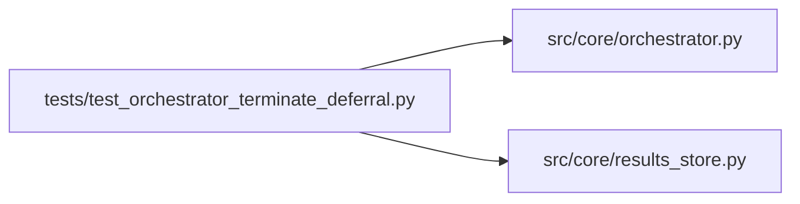

# test_orchestrator_terminate_deferral Module

**Path:** `tests/test_orchestrator_terminate_deferral.py`

## Description

DM-2 — defer TERMINATE_REQUEST when budget remains and best is fresh.

Run res_be66790e192e: agent emitted TERMINATE_REQUEST at iter 12 of a
50-iteration budget (24% used), last-best at iter 7 (gap=5), having
tried only 5 distinct configs. The orchestrator must reject the
terminate and inject a continuation nudge unless EITHER:
  * effective iteration count >= 50% of ``max_iterations`` (hard floor)
  * OR best_gap >= 5 (genuine stagnation already past the
    ``global_stagnation_window`` nudge).

Mirrors the existing global-stagnation test pattern; uses ResultsStore
directly so the helper exercises real session/iteration rows.

## Imports

| Source | Symbols |
|--------|---------|
| `__future__` | `annotations` |
| `anthropic` | `anthropic` |
| `json` | `json` |
| `os` | `os` |
| `pathlib` | `Path` |
| `pytest` | `pytest` |
| `src.core.orchestrator` | `AgentOrchestrator`, `ResearchConfig` |
| `src.core.results_store` | `ResultsStore` |
| `sys` | `sys` |
| `types` | `types` |

## Local dependency map

<!-- Auto-generated local dependency summary. Do not edit by hand. -->

### Internal neighbors

| Direction | Module |
|---|---|
| Outbound | [orchestrator](../modules/orchestrator.md) |
| Outbound | [results_store](../modules/results_store.md) |

### External packages

| Language | Used packages | Undeclared packages |
|---|---:|---:|
| python | 2 | 2 |

## Functions

| Function | Signature | Decorators | Description |
|----------|-----------|------------|-------------|
| `_new_store` | *(async)* `(tmp_path: Path) -> ResultsStore` | — | — |
| `_create_session` | *(async)* `(store: ResultsStore, sid: str, ws: Path, *, best_iteration: int \| None, best_metric: float \| None, max_iterations: int = 50) -> None` | — | — |
| `_config` | `(sid: str, *, max_iterations: int = 50) -> ResearchConfig` | — | — |
| `test_defers_terminate_when_budget_low_and_best_is_fresh` | *(async)* `(tmp_path: Path) -> None` | `@pytest.mark.asyncio` | — |
| `test_honors_terminate_when_budget_past_half` | *(async)* `(tmp_path: Path) -> None` | `@pytest.mark.asyncio` | — |
| `test_honors_terminate_when_best_gap_past_floor` | *(async)* `(tmp_path: Path) -> None` | `@pytest.mark.asyncio` | — |
| `test_honors_terminate_when_no_best_iteration_yet` | *(async)* `(tmp_path: Path) -> None` | `@pytest.mark.asyncio` | — |
| `test_duplicate_rejected_iterations_do_not_consume_budget` | *(async)* `(tmp_path: Path) -> None` | `@pytest.mark.asyncio` | — |
| `test_dm2_thresholds_locked` | `() -> None` | — | — |
