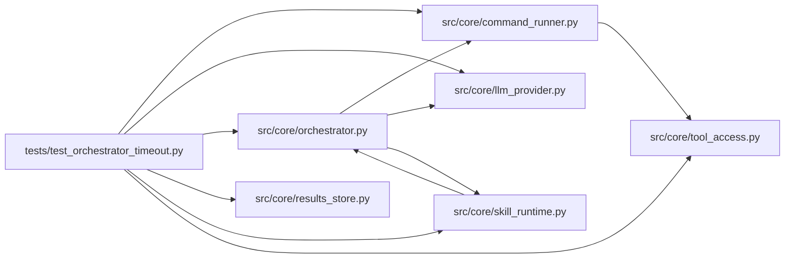

# test_orchestrator_timeout Module

**Path:** `tests/test_orchestrator_timeout.py`

## Description

Tests for ARC-011 P0-006 / P0-007 — hard wall-clock bound.

Verifies that a governed command which would overrun the session timeout is
reaped at the session boundary, and that an operator-stop cancel reaps the
in-flight subprocess tree through the ``CommandProcessRegistry`` even though
cancelling ``asyncio.to_thread`` cannot interrupt the worker thread that owns
the ``Popen`` handle.

  1. Orchestrator-level: a hung command is capped at the session's remaining
     soft budget, the command_runner's own psutil kill fires, and the session
     ends ``timed_out`` within ``timeout_s`` + slack (AC#1, AC#3).
  2. Registry-level: ``kill_all`` (invoked from the orchestrator's cancel
     handler) reaps an in-flight subprocess that a ``to_thread`` cancel could
     not (AC#2).
  3. Unit: the cap math (floor respected when budget ample; cap wins when
     budget < floor) and registry membership mechanics.

## Imports

| Source | Symbols |
|--------|---------|
| `__future__` | `annotations` |
| `anthropic` | `anthropic` |
| `asyncio` | `asyncio` |
| `hashlib` | `hashlib` |
| `os` | `os` |
| `pathlib` | `Path` |
| `psutil` | `psutil` |
| `pytest` | `pytest` |
| `src.core` | `orchestrator` |
| `src.core.command_runner` | `CommandProcessRegistry`, `CommandRunResult`, `GovernedCommandRunner` |
| `src.core.llm_provider` | `ProviderResponse`, `StopReason`, `ToolUseBlock`, `Usage` |
| `src.core.orchestrator` | `AgentOrchestrator`, `ResearchConfig`, `_tool_bash` |
| `src.core.results_store` | `ResultsStore` |
| `src.core.skill_runtime` | `ManifestSkillRuntime` |
| `src.core.tool_access` | `ToolAccessContext`, `build_tool_access_context` |
| `sys` | `sys` |
| `time` | `time` |
| `types` | `types` |
| `unittest.mock` | `AsyncMock`, `MagicMock`, `patch` |

## Local dependency map

<!-- Auto-generated local dependency summary. Do not edit by hand. -->

### Internal neighbors

| Direction | Module |
|---|---|
| Outbound | [command_runner](../modules/command_runner.md) |
| Outbound | [llm_provider](../modules/llm_provider.md) |
| Outbound | [orchestrator](../modules/orchestrator.md) |
| Outbound | [results_store](../modules/results_store.md) |
| Outbound | [skill_runtime](../modules/skill_runtime.md) |
| Outbound | [tool_access](../modules/tool_access.md) |

### External packages

| Language | Used packages | Undeclared packages |
|---|---:|---:|
| python | 3 | 3 |

## Classes

| Class | Line | Bases | Description |
|-------|------|-------|-------------|
| [_CapturingRunner](../entities/test_orchestrator_timeout_CapturingRunner.md) | 288 | — | Stand-in for GovernedCommandRunner that records the resolved timeout_s. |

## Functions

| Function | Signature | Decorators | Description |
|----------|-----------|------------|-------------|
| `_process_exists` | `(pid: int) -> bool` | — | — |
| `_make_config` | `(research_id: str, workspace: str, *, timeout_s: int = 2) -> ResearchConfig` | — | — |
| `_seed_session` | *(async)* `(store: ResultsStore, config: ResearchConfig) -> None` | — | — |
| `_fake_bash_tool_use` | `(command: str, tool_id: str = 'toolu_p006')` | — | A minimal ProviderResponse containing one bash tool_use block. |
| `_make_hanging_workspace` | `(tmp_path: Path) -> tuple[Path, Path, dict]` | — | A workspace with ``.venv/bin/python`` symlink + a digest-pinned hanging |
| `test_capped_command_is_reaped_and_session_times_out` | *(async)* `(tmp_path: Path, monkeypatch: pytest.MonkeyPatch) -> None` | `@pytest.mark.asyncio` | — |
| `test_registry_kill_all_reaps_in_flight_subprocess` | *(async)* `(tmp_path: Path) -> None` | `@pytest.mark.asyncio` | — |
| `_ws_access` | `() -> ToolAccessContext` | — | — |
| `test_command_timeout_cap_respects_floor_then_budget` | `() -> None` | — | Ample budget → the 900s floor holds; tight budget → the cap wins below it. |
| `test_registry_register_unregister_and_membership` | `() -> None` | — | — |
