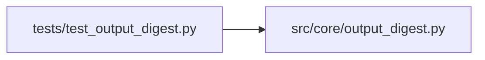

# test_output_digest Module

**Path:** `tests/test_output_digest.py`

## Description

Track D2 — bash output digest before agent context.

Pins:
1. Small outputs pass through byte-identical (no behavior change for normal
   commands).
2. Training-stream digests keep the decision inputs — ITERATION_RESULT, the
   final ``---`` metrics block, errors, per-fold gate lines — while progress
   ticks and library noise collapse into counters.
3. The hard cap holds even for pathological outputs.

## Imports

| Source | Symbols |
|--------|---------|
| `__future__` | `annotations` |
| `src.core.output_digest` | `DEFAULT_MAX_CHARS`, `digest_command_output` |

## Local dependency map

<!-- Auto-generated local dependency summary. Do not edit by hand. -->

### Internal neighbors

| Direction | Module |
|---|---|
| Outbound | [output_digest](../modules/output_digest.md) |

## Functions

| Function | Signature | Decorators | Description |
|----------|-----------|------------|-------------|
| `_training_stream` | `(n_progress: int = 2000) -> str` | — | — |
| `test_small_output_unchanged` | `() -> None` | — | — |
| `test_training_stream_keeps_decision_inputs` | `() -> None` | — | — |
| `test_hard_cap_holds` | `() -> None` | — | — |
| `test_disabled_via_zero_max_chars` | `() -> None` | — | — |
| `test_no_metrics_block_still_works` | `() -> None` | — | — |
| `test_default_cap_sane` | `() -> None` | — | — |
