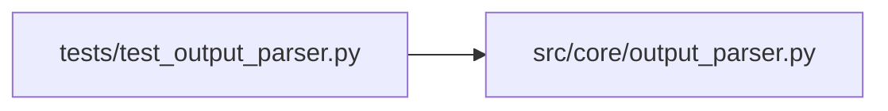

# test_output_parser Module

**Path:** `tests/test_output_parser.py`

## Description

Structural / contract tests for the ``OutputParser`` protocol (ARC-011
P1-010) and the ``DelimitedKVParser`` / ``JSONMarkerParser`` implementations
(P1-011 / P1-012).

Mirrors ``tests/test_state_store.py`` (P1-009) and ``tests/test_llm_provider.py``
(P1-005): these tests pin the public surface of the protocol and guard against
signature drift between the protocol declaration and the concrete
implementations. They are not behavioral tests — behavior is covered by the
existing ``experiment_parser`` suite and the X-002 parity fixtures
(``tests/parity/experiment_parser/``), which dispatch by string function name
through the ``experiment_parser`` facades that now delegate to these classes.

## Imports

| Source | Symbols |
|--------|---------|
| `__future__` | `annotations` |
| `inspect` | `inspect` |
| `pytest` | `pytest` |
| `src.core.output_parser` | `DelimitedKVParser`, `IterationResult`, `JSONMarkerParser`, `OutputParser` |
| `typing` | `Protocol` |

## Local dependency map

<!-- Auto-generated local dependency summary. Do not edit by hand. -->

### Internal neighbors

| Direction | Module |
|---|---|
| Outbound | [output_parser](../modules/output_parser.md) |

### External packages

| Language | Used packages | Undeclared packages |
|---|---:|---:|
| python | 1 | 1 |

## Functions

| Function | Signature | Decorators | Description |
|----------|-----------|------------|-------------|
| `test_output_parser_protocol_is_typing_time_contract` | `()` | — | ``OutputParser`` is a ``Protocol`` and is **not** ``@runtime_checkable``. |
| `test_output_parser_impl_satisfies_protocol_surface` | `(impl)` | `@pytest.mark.parametrize('impl', [DelimitedKVParser, JSONMarkerParser], ids=['DelimitedKVParser', 'JSONMarkerParser'])` | Every method declared on ``OutputParser`` exists on the impl. |
| `test_minimal_output_parser_satisfies_protocol` | `()` | — | A minimal stub with the two methods satisfies the protocol at the type |
| `test_iteration_result_is_typeddict_alias_of_flat_dict` | `()` | — | ``IterationResult`` is a ``TypedDict`` alias over the flat dict shape |
| `test_delimited_kv_parser_parse_returns_flat_dict_shape` | `()` | — | ``DelimitedKVParser.parse`` returns the same flat-dict shape |
| `test_delimited_kv_parser_failure_status_nulls_primary_metric` | `()` | — | The FAILURE_STATUSES primary_metric nulling survives the extraction |
| `test_json_marker_parser_parse_iteration_returns_dict_or_none` | `()` | — | ``JSONMarkerParser.parse_iteration`` returns the parsed dict on a |
| `test_json_marker_parser_parse_marker_is_alias_of_parse_iteration` | `()` | — | The historical ``parse_marker`` name is an alias for |
| `test_json_marker_parser_ignores_session_nonce` | `()` | — | ``parse_iteration`` accepts ``session_nonce`` for forward-compat (the P4 |
