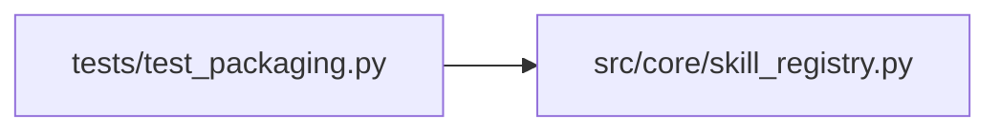

# test_packaging Module

**Path:** `tests/test_packaging.py`

## Description

Release metadata and archive-content regressions.

Set AUTORESEARCH_DIST_DIR to freshly built wheel/sdist artifacts to check
archive contents. Ordinary unit runs do not build or install anything.

## Imports

| Source | Symbols |
|--------|---------|
| `__future__` | `annotations` |
| `os` | `os` |
| `pathlib` | `Path` |
| `pytest` | `pytest` |
| `src.core.skill_registry` | `DEFAULT_SKILLS_ROOT` |
| `subprocess` | `subprocess` |
| `sys` | `sys` |
| `tarfile` | `tarfile` |
| `tomllib` | `tomllib` |
| `yaml` | `yaml` |
| `zipfile` | `zipfile` |

## Local dependency map

<!-- Auto-generated local dependency summary. Do not edit by hand. -->

### Internal neighbors

| Direction | Module |
|---|---|
| Outbound | [skill_registry](../modules/skill_registry.md) |

### External packages

| Language | Used packages | Undeclared packages |
|---|---:|---:|
| python | 2 | 1 |

## Functions

| Function | Signature | Decorators | Description |
|----------|-----------|------------|-------------|
| `_pyproject_includes` | `() -> list[dict]` | — | Parse the ``tool.poetry`` include table from pyproject.toml. |
| `test_pyproject_includes_bundled_skill_dirs_explicitly_for_both_formats` | `()` | — | — |
| `test_pyproject_does_not_package_drafts_or_the_whole_skills_tree` | `()` | — | — |
| `test_bundled_skill_dirs_each_carry_a_loadable_manifest` | `()` | — | — |
| `test_default_skills_root_is_sibling_of_installed_src_package` | `()` | — | Conceptual pin for the installed-layout contract (Dockerfile parity). |
| `test_release_archives_contain_only_bundled_skills` | `(archive_format)` | `@pytest.mark.parametrize('archive_format', ['wheel', 'sdist'])` | — |
| `test_installed_package_resolves_pinned_evaluators_outside_checkout` | `(tmp_path)` | — | Installed-layout smoke: with cwd outside the checkout and imports |
