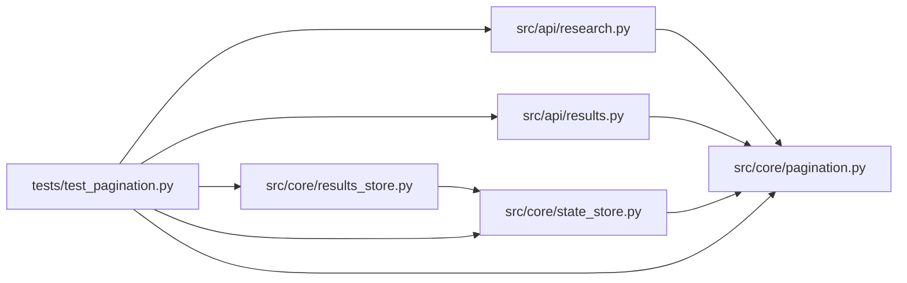

# test_pagination Module

**Path:** `tests/test_pagination.py`

## Description

Cursor-pagination tests (ARC-011 P0-015..019).

Covers:
  * the opaque cursor helper (encode/decode round-trip, malformed-input
    fail-open, limit clamping) — unit,
  * ``build_cursor_page`` envelope construction,
  * real-store keyset behavior for sessions / pipelines / iterations:
    forward iteration, tiebreaker determinism on shared timestamps,
    concurrent-insertion stability (cursor vs offset drift), cursor round-trip
    integrity, reverse (store-layer ``reverse=True``), and opt-in/bare-list
    parity for iterations,
  * API-layer envelope selection (cursor path vs legacy offset path) via
    direct handler calls.

Design reference: ``src/core/pagination.py`` module docstring (ARC-011 P0-016).

## Imports

| Source | Symbols |
|--------|---------|
| `__future__` | `annotations` |
| `pathlib` | `Path` |
| `pytest` | `pytest` |
| `src.api` | `research`, `results` |
| `src.core.pagination` | `DEFAULT_PAGE_SIZE`, `MAX_PAGE_SIZE`, `build_cursor_page`, `clamp_limit`, `decode_cursor`, `encode_cursor` |
| `src.core.results_store` | `ResultsStore` |
| `src.core.state_store` | `_LATEST_SCHEMA_VERSION` |

## Local dependency map

<!-- Auto-generated local dependency summary. Do not edit by hand. -->

### Internal neighbors

| Direction | Module |
|---|---|
| Outbound | [research](../modules/research.md) |
| Outbound | [results](../modules/results.md) |
| Outbound | [pagination](../modules/pagination.md) |
| Outbound | [results_store](../modules/results_store.md) |
| Outbound | [state_store](../modules/state_store.md) |

### External packages

| Language | Used packages | Undeclared packages |
|---|---:|---:|
| python | 1 | 1 |

## Classes

| Class | Line | Bases | Description |
|-------|------|-------|-------------|
| [TestCursorHelper](../entities/TestCursorHelper.md) | 102 | — | — |
| [TestBuildCursorPage](../entities/TestBuildCursorPage.md) | 174 | — | — |
| [TestSessionsCursorPagination](../entities/TestSessionsCursorPagination.md) | 198 | — | — |
| [TestPipelinesCursorPagination](../entities/TestPipelinesCursorPagination.md) | 283 | — | — |
| [TestIterationsCursorPagination](../entities/TestIterationsCursorPagination.md) | 310 | — | — |
| [TestApiEnvelopeSelection](../entities/TestApiEnvelopeSelection.md) | 369 | — | — |

## Functions

| Function | Signature | Decorators | Description |
|----------|-----------|------------|-------------|
| `store` | *(async)* `(tmp_path: Path) -> ResultsStore` | `@pytest.fixture` | — |
| `_set_started_at` | *(async)* `(store: ResultsStore, table: str, row_id: str, ts: str) -> None` | — | Force a row's ``started_at`` so tiebreaker/concurrency scenarios are exact. |
| `_sessions_extractor` | `(row)` | — | — |
| `_iterations_extractor` | `(row)` | — | — |
| `test_v5_indexes_present_after_initialize` | *(async)* `(tmp_path: Path) -> None` | `@pytest.mark.asyncio` | After ``initialize()``, the store reports the latest schema version |
