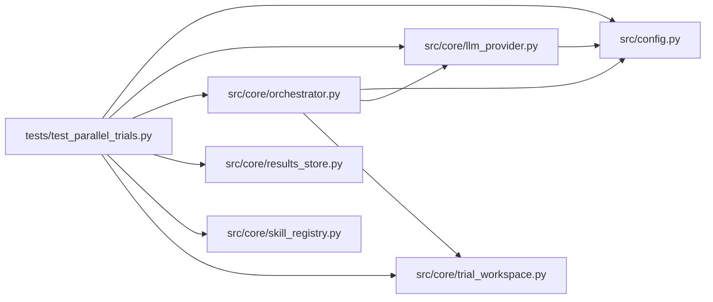

# test_parallel_trials Module

**Path:** `tests/test_parallel_trials.py`

## Description

P2 parallel-trial dispatch tests (the ``execution.concurrency`` flip-on).

Drives a real ``AgentOrchestrator.run()`` session with a synthetic skill whose
manifest declares ``execution.concurrency: 2`` and a scripted provider that
emits **two** sanctioned experiment commands in a single turn. Proves:

* both commands run concurrently (overlapping wall-clock, not back-to-back);
* each runs inside its own staged trial directory and leaves its artifacts
  there (the session workspace is untouched by trial outputs);
* each trial records its own iteration (per-trial recording), with
  ``trial_dir``/``trial_seq`` provenance on the row;
* the default ``concurrency: 1`` control keeps the sequential
  first-marker-wins behavior and never allocates a trial directory.

The synthetic skill is authored by loading the real ``prompt-engineering``
manifest and overriding the sections under test, so schema validity is
guaranteed by the same loader the service uses.

## Imports

| Source | Symbols |
|--------|---------|
| `__future__` | `annotations` |
| `asyncio` | `asyncio` |
| `datetime` | `datetime` |
| `os` | `os` |
| `pathlib` | `Path` |
| `pytest` | `pytest` |
| `sqlite3` | `sqlite3` |
| `src.config` | `settings` |
| `src.core` | `orchestrator`, `skill_registry` |
| `src.core.llm_provider` | `ErrorClass`, `ProviderCapabilities`, `ProviderResponse`, `StopReason`, `TextBlock`, `ToolUseBlock`, `Usage` |
| `src.core.orchestrator` | `AgentOrchestrator`, `ResearchConfig` |
| `src.core.results_store` | `ResultsStore` |
| `src.core.skill_registry` | `SkillRegistry` |
| `src.core.trial_workspace` | `TRIALS_DIRNAME` |
| `sys` | `sys` |
| `unittest.mock` | `AsyncMock`, `patch` |
| `yaml` | `yaml` |

## Local dependency map

<!-- Auto-generated local dependency summary. Do not edit by hand. -->

### Internal neighbors

| Direction | Module |
|---|---|
| Outbound | [config](../modules/config.md) |
| Outbound | [llm_provider](../modules/llm_provider.md) |
| Outbound | [orchestrator](../modules/orchestrator.md) |
| Outbound | [results_store](../modules/results_store.md) |
| Outbound | [skill_registry](../modules/skill_registry.md) |
| Outbound | [trial_workspace](../modules/trial_workspace.md) |

### External packages

| Language | Used packages | Undeclared packages |
|---|---:|---:|
| python | 2 | 1 |

## Classes

| Class | Line | Bases | Description |
|-------|------|-------|-------------|
| [_ScriptedProvider](../entities/ScriptedProvider.md) | 158 | — | Issues two sanctioned eval commands in one turn, then terminates. |

## Functions

| Function | Signature | Decorators | Description |
|----------|-----------|------------|-------------|
| `_write_synthetic_skill` | `(skills_root: Path, *, concurrency: int \| None) -> Path` | — | Author a schema-valid skill by overriding the real manifest. |
| `_run_session` | *(async)* `(monkeypatch, tmp_path, *, concurrency: int \| None, absolute_config: bool = False) -> tuple[ResultsStore, str, Path, Path]` | — | Drive one real run() session; returns (store, id, session ws, root). |
| `test_parallel_trials_overlap_and_record_each` | *(async)* `(monkeypatch, tmp_path)` | `@pytest.mark.asyncio` | concurrency=2: both trials run in isolated dirs, concurrently, and each |
| `test_sequential_default_never_allocates_trials` | *(async)* `(monkeypatch, tmp_path)` | `@pytest.mark.asyncio` | concurrency=1 (default): no trial dirs; first-marker-wins preserved. |
