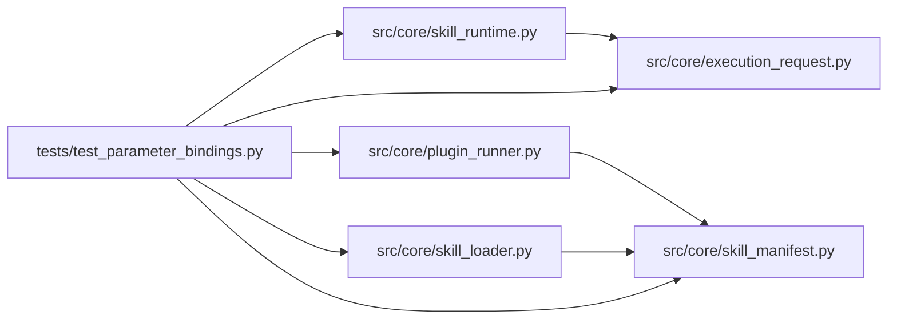

# test_parameter_bindings Module

**Path:** `tests/test_parameter_bindings.py`

## Description

Parameter-to-work binding contract: traceability and fixed-argument enforcement.

Submitted (nondefault) values trace from the resolved skill_params into the
rendered commands, the resolved execution request, and the actual evaluator
behavior for every bundled skill. Operator-fixed arguments (demo, dataset,
scorer, bound parameter flags) cannot be changed or dropped by model-authored
argv, duplicate/alias override attempts are rejected, live and demo render
with identical bound values, and no core branch keyed on a skill name remains.

## Imports

| Source | Symbols |
|--------|---------|
| `__future__` | `annotations` |
| `asyncio` | `asyncio` |
| `hashlib` | `hashlib` |
| `json` | `json` |
| `pathlib` | `Path` |
| `pytest` | `pytest` |
| `shlex` | `shlex` |
| `src.core.execution_request` | `resolve_execution_request` |
| `src.core.plugin_runner` | `PluginCaps`, `PluginRunner` |
| `src.core.skill_loader` | `load_skill_manifest` |
| `src.core.skill_manifest` | `ParameterBindings`, `ResearchSkillManifest` |
| `src.core.skill_runtime` | `ManifestSkillRuntime` |
| `subprocess` | `subprocess` |
| `sys` | `sys` |
| `tempfile` | `tempfile` |
| `types` | `types` |
| `yaml` | `yaml` |

## Local dependency map

<!-- Auto-generated local dependency summary. Do not edit by hand. -->

### Internal neighbors

| Direction | Module |
|---|---|
| Outbound | [execution_request](../modules/execution_request.md) |
| Outbound | [plugin_runner](../modules/plugin_runner.md) |
| Outbound | [skill_loader](../modules/skill_loader.md) |
| Outbound | [skill_manifest](../modules/skill_manifest.md) |
| Outbound | [skill_runtime](../modules/skill_runtime.md) |

### External packages

| Language | Used packages | Undeclared packages |
|---|---:|---:|
| python | 2 | 1 |

## Functions

| Function | Signature | Decorators | Description |
|----------|-----------|------------|-------------|
| `_runtime` | `(skill: str) -> ManifestSkillRuntime` | — | — |
| `_config` | `(skill: str, **params)` | — | — |
| `test_nondefault_values_trace_into_rendered_commands` | `(skill: str) -> None` | `@pytest.mark.parametrize('skill', sorted(NONDEFAULT))` | API-submitted values are visible in both rendered commands. |
| `test_live_and_demo_binding_parity` | `(skill: str) -> None` | `@pytest.mark.parametrize('skill', sorted(NONDEFAULT))` | Live and demo commands carry identical bound flag values. |
| `test_no_core_branch_on_skill_name` | `() -> None` | — | Bundled-skill differences live in manifest bindings, not core branches. |
| `test_bindings_must_reference_declared_parameters` | `() -> None` | — | — |
| `_resolve_fixture` | `(tmp_path: Path, bound: dict[str, str])` | — | — |
| `_resolve` | `(ws: str, session: str, ext: dict, command: str)` | — | — |
| `test_model_cannot_change_operator_fixed_args` | `(tmp_path: Path) -> None` | — | — |
| `test_duplicate_and_alias_override_attempts_rejected` | `(tmp_path: Path) -> None` | — | — |
| `test_missing_bound_args_are_supplied_in_the_request` | `(tmp_path: Path) -> None` | — | Dropping a bound flag does not unbind it: the request carries it. |
| `test_evaluator_behavior_follows_nondefault_values` | `(tmp_path: Path) -> None` | — | The DB bench reports the submitted duration and gates on the submitted |
| `test_code_skill_uses_requested_candidate_source` | `(tmp_path: Path) -> None` | — | The code skill initializes and evaluates the requested target file. |
| `test_command_template_placeholders_are_validated_at_load` | `() -> None` | — | — |
