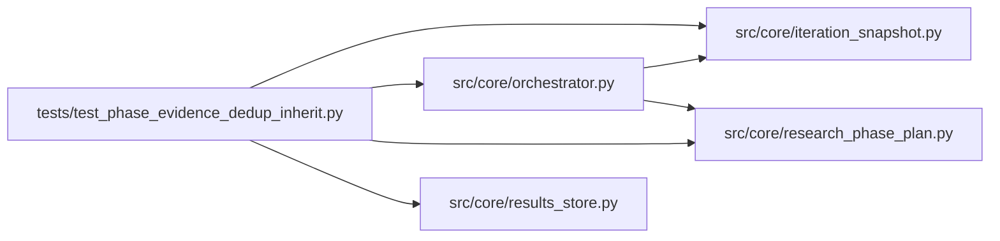

# test_phase_evidence_dedup_inherit Module

**Path:** `tests/test_phase_evidence_dedup_inherit.py`

## Description

Issue 5 — noop-phase evidence inheritance on a dedup hit.

`adaptive_feature_sweeps` advances on a single in-phase iteration carrying an
accepted noop (`adaptive_features_unavailable`). For an instrument where
adaptive features simply do not apply, that noop is *config-invariant* — only
the already-recorded config produces it, so a re-run to assert the evidence
dedups. Rejecting it with an evidence-stripped `rejected_duplicate` marker
wedges the phase forever. The orchestrator must instead inherit the accepted
evidence from the completed prior iteration so the phase advances, without the
agent having to perturb a research-irrelevant knob.

## Imports

| Source | Symbols |
|--------|---------|
| `__future__` | `annotations` |
| `anthropic` | `anthropic` |
| `json` | `json` |
| `os` | `os` |
| `pathlib` | `Path` |
| `pytest` | `pytest` |
| `src.core.iteration_snapshot` | `build_trial_identity`, `trial_identity_hash` |
| `src.core.orchestrator` | `AgentOrchestrator`, `ResearchConfig` |
| `src.core.research_phase_plan` | `build_phase_state` |
| `src.core.results_store` | `ResultsStore` |
| `sys` | `sys` |
| `types` | `types`, `ModuleType` |
| `typing` | `cast` |

## Local dependency map

<!-- Auto-generated local dependency summary. Do not edit by hand. -->

### Internal neighbors

| Direction | Module |
|---|---|
| Outbound | [iteration_snapshot](../modules/iteration_snapshot.md) |
| Outbound | [orchestrator](../modules/orchestrator.md) |
| Outbound | [research_phase_plan](../modules/research_phase_plan.md) |
| Outbound | [results_store](../modules/results_store.md) |

### External packages

| Language | Used packages | Undeclared packages |
|---|---:|---:|
| python | 2 | 2 |

## Functions

| Function | Signature | Decorators | Description |
|----------|-----------|------------|-------------|
| `_identity_hash` | `()` | — | — |
| `_new_store` | *(async)* `(tmp_path: Path) -> ResultsStore` | — | — |
| `_create_session` | *(async)* `(store: ResultsStore, sid: str, ws: Path) -> None` | — | — |
| `_seed_iteration` | *(async)* `(store: ResultsStore, *, sid: str, iteration: int, search_phase: str, with_noop: bool, duplicate_reason: str \| None = None) -> None` | — | — |
| `test_recorded_noop_iteration_completes_phase` | *(async)* `(tmp_path: Path) -> None` | `@pytest.mark.asyncio` | — |
| `test_dedup_in_noop_phase_inherits_evidence` | *(async)* `(tmp_path: Path) -> None` | `@pytest.mark.asyncio` | — |
| `test_dwell_gated_phase_still_rejects` | *(async)* `(tmp_path: Path) -> None` | `@pytest.mark.asyncio` | — |
| `test_no_inherit_when_prior_is_rejected_duplicate` | *(async)* `(tmp_path: Path) -> None` | `@pytest.mark.asyncio` | — |
