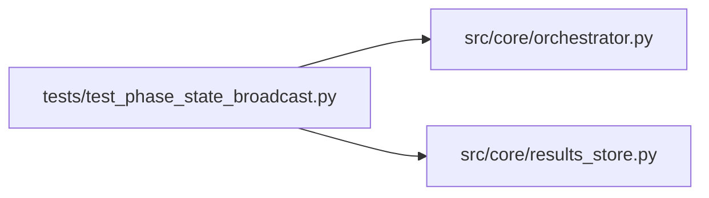

# test_phase_state_broadcast Module

**Path:** `tests/test_phase_state_broadcast.py`

## Description

_Auto-generated from `tests/test_phase_state_broadcast.py`._

## Imports

| Source | Symbols |
|--------|---------|
| `__future__` | `annotations` |
| `pytest` | `pytest` |
| `src.core.orchestrator` | `orchestrator_module`, `AgentOrchestrator` |
| `src.core.results_store` | `ResultsStore` |

## Local dependency map

<!-- Auto-generated local dependency summary. Do not edit by hand. -->

### Internal neighbors

| Direction | Module |
|---|---|
| Outbound | [orchestrator](../modules/orchestrator.md) |
| Outbound | [results_store](../modules/results_store.md) |

### External packages

| Language | Used packages | Undeclared packages |
|---|---:|---:|
| python | 1 | 1 |

## Classes

| Class | Line | Bases | Description |
|-------|------|-------|-------------|
| [FakeBroadcaster](../entities/test_phase_state_broadcast_FakeBroadcaster.md) | 10 | — | — |

## Functions

| Function | Signature | Decorators | Description |
|----------|-----------|------------|-------------|
| `test_refresh_phase_state_broadcasts_updated_state` | *(async)* `(tmp_path, monkeypatch)` | `@pytest.mark.asyncio` | — |
