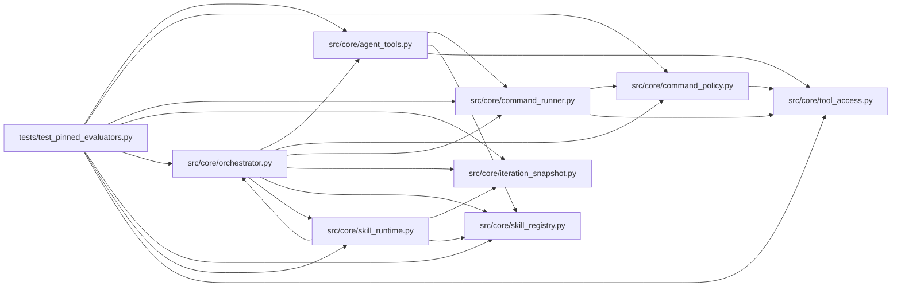

# test_pinned_evaluators Module

**Path:** `tests/test_pinned_evaluators.py`

## Description

Pinned-evaluator and interpreter-environment regressions.

Declared evaluator entrypoints must run only from digest-pinned package
assets; the sanctioned interpreter and the import/search path must not be
shadowable from the candidate tree; attempt provenance records the
evaluator and environment identity computed server-side at launch; and
candidate execution sees neither result-signing nor operator credentials.

## Imports

| Source | Symbols |
|--------|---------|
| `__future__` | `annotations` |
| `hashlib` | `hashlib` |
| `json` | `json` |
| `os` | `os` |
| `pathlib` | `Path` |
| `src.core.agent_tools` | `_execute_tool` |
| `src.core.command_policy` | `evaluate_command_policy` |
| `src.core.command_runner` | `GovernedCommandRunner` |
| `src.core.iteration_snapshot` | `build_iteration_attempt_snapshot` |
| `src.core.orchestrator` | `AgentOrchestrator` |
| `src.core.skill_registry` | `SkillRegistry` |
| `src.core.skill_runtime` | `ManifestSkillRuntime` |
| `src.core.tool_access` | `build_tool_access_context`, `build_tool_access_context` |
| `sys` | `sys` |

## Local dependency map

<!-- Auto-generated local dependency summary. Do not edit by hand. -->

### Internal neighbors

| Direction | Module |
|---|---|
| Outbound | [agent_tools](../modules/agent_tools.md) |
| Outbound | [command_policy](../modules/command_policy.md) |
| Outbound | [command_runner](../modules/command_runner.md) |
| Outbound | [iteration_snapshot](../modules/iteration_snapshot.md) |
| Outbound | [orchestrator](../modules/orchestrator.md) |
| Outbound | [skill_registry](../modules/skill_registry.md) |
| Outbound | [skill_runtime](../modules/skill_runtime.md) |
| Outbound | [tool_access](../modules/tool_access.md) |

## Functions

| Function | Signature | Decorators | Description |
|----------|-----------|------------|-------------|
| `_workspace` | `(tmp_path: Path) -> tuple[str, str]` | — | — |
| `_pin_script` | `(base: Path, script_name: str, content: str) -> tuple[dict, Path]` | — | Create a digest-pinned packaged script outside the workspace. |
| `test_workspace_shadow_of_declared_evaluator_never_runs` | `(tmp_path: Path)` | — | — |
| `test_declared_script_without_pinned_asset_fails_instead_of_workspace_fallback` | `(tmp_path: Path)` | — | — |
| `test_changed_pinned_evaluator_fails_before_launch` | `(tmp_path: Path)` | — | — |
| `test_missing_pinned_evaluator_fails_before_launch` | `(tmp_path: Path)` | — | — |
| `test_missing_pinned_interpreter_fails_before_launch` | `(tmp_path: Path)` | — | — |
| `test_full_tool_loop_executes_packaged_evaluator_not_workspace_shadow` | `(tmp_path: Path)` | — | — |
| `test_planted_interpreter_under_candidate_tree_is_never_launched` | `(tmp_path: Path)` | — | — |
| `test_import_and_search_path_shadowing_cannot_change_evaluator_imports` | `(tmp_path: Path, monkeypatch)` | — | — |
| `test_evaluator_child_env_carries_nonce_but_no_operator_credentials` | `(tmp_path: Path, monkeypatch)` | — | — |
| `test_evaluation_data_digests_record_identity_and_refuse_aliased_data` | `(tmp_path: Path)` | — | — |
| `test_attempt_provenance_carries_server_computed_execution_identity` | `(tmp_path: Path)` | — | — |
| `test_manifest_runtime_extension_pins_packaged_scripts_with_digests` | `()` | — | — |
