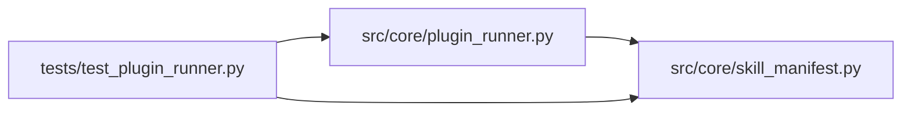

# test_plugin_runner Module

**Path:** `tests/test_plugin_runner.py`

## Description

PluginRunner tests (ARC-011 P5-005 / X-004).

Covers the governed-subprocess contract for skill-supplied Python plugins
(``bootstrap.py`` / ``parser.py`` / ``preflight.py`` / ``resolve_identity.py``):

* the strict env allow-list strips server secrets (X-004 T1 / §4.2);
* path confinement rejects a plugin escaping its skill dir (D4);
* JSON-in / JSON-out happy path works end-to-end;
* fail-closed on non-zero exit, invalid JSON, timeout, and missing file;
* resource caps (RSS/CPU) flag runaway plugins (D6);
* the nonce re-validation invariant (T6) holds — a plugin cannot self-certify.

These are the load-bearing safety tests; the ``BootstrapRunner`` (P5-009)
extends them with artifact + idempotency coverage.

## Imports

| Source | Symbols |
|--------|---------|
| `__future__` | `annotations` |
| `asyncio` | `asyncio` |
| `json` | `json` |
| `os` | `os` |
| `pathlib` | `Path` |
| `pytest` | `pytest` |
| `src.core.plugin_runner` | `PluginResult`, `PluginRunner`, `_build_plugin_env` |
| `src.core.skill_manifest` | `PluginCaps` |
| `sys` | `sys` |
| `textwrap` | `textwrap` |

## Local dependency map

<!-- Auto-generated local dependency summary. Do not edit by hand. -->

### Internal neighbors

| Direction | Module |
|---|---|
| Outbound | [plugin_runner](../modules/plugin_runner.md) |
| Outbound | [skill_manifest](../modules/skill_manifest.md) |

### External packages

| Language | Used packages | Undeclared packages |
|---|---:|---:|
| python | 1 | 1 |

## Classes

| Class | Line | Bases | Description |
|-------|------|-------|-------------|
| [TestPluginEnvContract](../entities/TestPluginEnvContract.md) | 53 | — | The plugin child env must be default-deny and strip every server secret. |
| [TestPluginHappyPath](../entities/TestPluginHappyPath.md) | 105 | — | — |
| [TestPluginFailClosed](../entities/TestPluginFailClosed.md) | 162 | — | — |
| [TestPluginPathConfinement](../entities/TestPluginPathConfinement.md) | 260 | — | — |
| [TestPluginCannotForgeVerifiedMetric](../entities/TestPluginCannotForgeVerifiedMetric.md) | 307 | — | X-004 T6: metrics trust stays server-side. A plugin parser produces only a |

## Functions

| Function | Signature | Decorators | Description |
|----------|-----------|------------|-------------|
| `_write_plugin` | `(path: Path, body: str) -> None` | — | — |
| `skill_dir` | `(tmp_path: Path) -> Path` | `@pytest.fixture()` | A throwaway skill package dir. |
