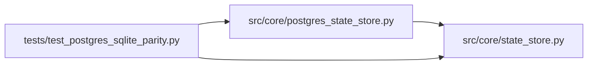

# test_postgres_sqlite_parity Module

**Path:** `tests/test_postgres_sqlite_parity.py`

## Description

ARC-011 P6-002b — dual-backend parity sweep.

The gate that proves ``PostgresStateStore`` is behavior-identical to
``SQLiteStateStore``. Runs the same representative write+read sequence against
both backends and asserts the observable results match (modulo backend-specific
column types like rowid vs BIGSERIAL id, which are normalized).

Mirrors the P1-007 "parity suite green" rule: a behavior-touching change to
either backend must keep this green.

Skipped when ``AUTORESEARCH_DATABASE_URL`` is unset (the SQLite-only half still
runs, proving SQLite is unchanged — the default deployment path).

## Imports

| Source | Symbols |
|--------|---------|
| `__future__` | `annotations` |
| `asyncpg` | `asyncpg` |
| `os` | `os` |
| `pytest` | `pytest` |
| `src.core.postgres_state_store` | `PostgresStateStore` |
| `src.core.state_store` | `SQLiteStateStore` |
| `typing` | `Any`, `Dict`, `List` |
| `uuid` | `uuid` |

## Local dependency map

<!-- Auto-generated local dependency summary. Do not edit by hand. -->

### Internal neighbors

| Direction | Module |
|---|---|
| Outbound | [postgres_state_store](../modules/postgres_state_store.md) |
| Outbound | [state_store](../modules/state_store.md) |

### External packages

| Language | Used packages | Undeclared packages |
|---|---:|---:|
| python | 2 | 1 |

## Functions

| Function | Signature | Decorators | Description |
|----------|-----------|------------|-------------|
| `_base_pg_dsn` | `() -> str \| None` | — | — |
| `_normalize_row` | `(row: Dict[str, Any] \| None) -> Dict[str, Any] \| None` | — | Drop backend-specific columns and coerce None/0/empty to a comparable form. |
| `_normalize_rows` | `(rows: List[Dict[str, Any]]) -> List[Dict[str, Any]]` | — | — |
| `sqlite_store` | *(async)* `(tmp_path)` | `@pytest.fixture()` | — |
| `pg_store_parity` | *(async)* `()` | `@pytest.fixture()` | PostgresStateStore against a throwaway DB; skip if no DSN. |
| `_run_full_sequence` | *(async)* `(store: Any, *, sid: str) -> Dict[str, Any]` | — | Run a representative write+read sequence; return a snapshot of results. |
| `test_full_sequence_parity_across_backends` | *(async)* `(sqlite_store, pg_store_parity)` | `@pytest.mark.postgres` | The same write+read sequence produces identical observable results on |
| `test_sqlite_full_sequence_unchanged` | *(async)* `(sqlite_store)` | — | The SQLite sequence runs and produces the expected shape. |
