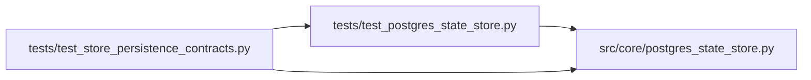

# test_postgres_state_store Module

**Path:** `tests/test_postgres_state_store.py`

## Description

ARC-011 P6-002a — PostgresStateStore write-path tests.

Validates the write methods + lifecycle + the atomic idempotency contract
(``INSERT … ON CONFLICT DO NOTHING RETURNING``) against a live Postgres. Read
methods (P6-002b) are exercised separately by the dual-backend parity sweep.

Skipped when ``AUTORESEARCH_DATABASE_URL`` is unset (default CI run has no
Postgres); the dedicated ``postgres`` CI job (P6-007) wires the service.

## Imports

| Source | Symbols |
|--------|---------|
| `__future__` | `annotations` |
| `asyncio` | `asyncio` |
| `asyncpg` | `asyncpg`, `asyncpg` |
| `os` | `os` |
| `pytest` | `pytest` |
| `src.core.postgres_state_store` | `PostgresStateStore` |
| `typing` | `AsyncIterator` |
| `uuid` | `uuid` |

## Local dependency map

<!-- Auto-generated local dependency summary. Do not edit by hand. -->

### Internal neighbors

| Direction | Module |
|---|---|
| Inbound | [test_store_persistence_contracts](../modules/test_store_persistence_contracts.md) |
| Outbound | [postgres_state_store](../modules/postgres_state_store.md) |

### External packages

| Language | Used packages | Undeclared packages |
|---|---:|---:|
| python | 2 | 1 |

## Functions

| Function | Signature | Decorators | Description |
|----------|-----------|------------|-------------|
| `_base_dsn` | `() -> str \| None` | — | — |
| `_admin_dsn` | `() -> str \| None` | `@pytest.fixture(scope='module')` | — |
| `pg_dsn` | *(async)* `(_admin_dsn: str \| None) -> AsyncIterator[str]` | `@pytest.fixture()` | A per-test throwaway database (or skip). |
| `pg_store` | *(async)* `(pg_dsn: str)` | `@pytest.fixture()` | A fresh PostgresStateStore per test against the throwaway DB. |
| `_insert_session_row` | *(async)* `(store, session_id: str) -> None` | — | Insert a research_sessions row directly, bypassing create_session. |
| `test_initialize_creates_schema_and_sets_version` | *(async)* `(pg_store)` | — | — |
| `test_session_lock_serializes_same_session` | *(async)* `(pg_store)` | — | Two concurrent session_lock holders on the SAME session are serialized. |
| `test_session_lock_different_sessions_parallel` | *(async)* `(pg_store)` | — | Different sessions are NOT serialized against each other (no false blocking). |
| `test_begin_idempotency_record_atomic_reserve` | *(async)* `(pg_store)` | — | Concurrent reserve-or-return on the same key yields exactly one 'running' |
| `test_complete_then_delete_idempotency_record` | *(async)* `(pg_store)` | — | — |
| `test_create_session_inserts_row` | *(async)* `(pg_store)` | — | create_session's INSERT works; the read-roundtrip is P6-002b. |
| `test_update_session_unconditional` | *(async)* `(pg_store)` | — | Unconditional update_session (SQLite-parity path) writes the column. |
| `test_update_session_fencing_rejects_stale_epoch` | *(async)* `(pg_store)` | — | The P6-004 fence: update_session with a stale lock_epoch returns None |
| `test_add_iteration_unique_constraint` | *(async)* `(pg_store)` | — | — |
| `test_record_and_finish_runtime_command` | *(async)* `(pg_store)` | — | — |
| `test_delete_session_cascades_children` | *(async)* `(pg_store)` | — | — |
